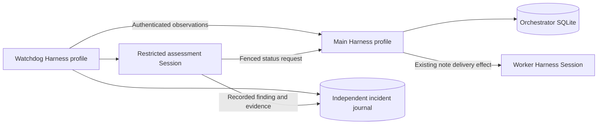

# 009 Independent supervision

The watchdog runs in a **separate DeepSeek Harness process and profile**, with its own Session, model selection, state lock,
SQLite database and local status endpoint. Its polling loop continues while its assessment Session is busy or the main
agent is unavailable. It retains Harness's model loop and Session persistence; it does not introduce another agent runtime.

It extends the [deployment model](006-deployment.md) and uses the existing [Engine and delivery effects](007-architecture.md).

## Data and authority



The main process writes `watchdog.token` into its state directory, with mode `0600`. The watchdog reads that file through
host code. The credential never enters its model prompt or tool responses. This increment uses a literal `127.0.0.1` HTTP
origin; remote deployment must supply a separately authenticated transport in a later increment. Neither service binds a
public management port. This is process separation on a trusted host, not isolation from other code running as the same OS user.

The main process exposes two additional management endpoints, retaining the existing loopback/header/origin checks and
requiring the watchdog bearer token:

| Operation | Contract |
| --- | --- |
| `GET /orchestrator/api/supervision?offset=0` | Bounded ticket observations, health, pause/setup state, process identity and snapshot version; at most 100 tickets per page |
| `POST /orchestrator/api/supervision/intervene` | Strict `request_status` command with request ID, observed process ID, ticket ID and exact ticket revision |

Observations truncate titles, scope and reports. The client rejects pages from different versions, duplicate tickets,
non-advancing pagination, redirects, responses over 1 MiB and snapshots over 100 pages. One 10-second deadline bounds the
entire snapshot read, including all pages. Partial snapshots never resolve
incidents. Failed observations update the independent monitor status and preserve existing incidents.

Only **one progress request per assignment** can be accepted. The main process checks current setup/pause state, ticket
liveness, assignment stage and revision inside the same SQLite transaction that enqueues the note and records the receipt.
A repeated request returns its original receipt; reusing its ID with different content is refused. A receipt can be recovered
after restart, but a new command from an old process observation cannot execute. Failed transactions record neither the
nudge nor the receipt.

The request is a context-only Engine `note`. It does not renew a mandate, create an assignment, impersonate a person,
retry shell commands, stop work, change policy or publish anything. Waiting-for-person stages are not nudged.

## Semantic supervision

The watcher opens incidents for working tickets whose ticket record has not changed for `staleMs`, and for blocked or
failed tickets. A lack of updates is a reason to inspect work, not proof of deadlock. The current evidence is the bounded
scope, latest report and execution stage; it does not include raw shell output or the entire worker transcript.

Its dedicated preset contains no shell, filesystem, subagent or general management tools. Inherited tools are masked,
and an execution guard permits only:

| Tool | Capability |
| --- | --- |
| `watchdog_observe` | Read local incidents and observed main-service health |
| `watchdog_assess` | Record a version-bound `progressing`, `stalled`, `blocked`, `drift` or `unknown` finding with evidence |
| `watchdog_request_status` | Request a progress report after a current `stalled` finding, subject to the main process's independent checks |

All task content is treated as untrusted observation. No model-supplied recovery text or arbitrary API path is accepted.
An old diagnosis is refused after an observation changes or an incident closes. Only a recent successful poll permits
an intervention. Pausing processing closes active inspection episodes without inventing a successful task outcome.

By default, the watcher polls every 30 seconds, inspects work unchanged for 15 minutes, and sends at most one assessment
per poll. An unassessed incident can receive at most three distinct assessment deliveries per review cycle, at least five
minutes apart. Unchanged incidents receive a new review cycle after one hour. A 90-second assessment deadline cancels
the watcher Session; polling continues. Cancellation is observed on poll boundaries, so its delay can include one poll
interval and an in-flight transport timeout. These are delivery/time limits, not provider billing limits.

Each reserved delivery has a persisted ID. A failed flush or watchdog restart retries the same ID through Harness's
existing `AgentDelivery` deduplication. Diagnoses, observations and intervention results are recorded in `watchdog.sqlite`.
Model failures are reported separately from main-service reachability. Exhausted assessment deliveries and findings that
require a person remain visible in status; there is no automatic external notification or process restart in this increment.

## Install and run

Complete the main profile's setup first, including configuring its model provider. Build this checkout with `pnpm check`.
For a **new** watchdog profile, from the checkout:

```sh
dsh superagent-watchdog --from-default-profile web --dump-config > /dev/null
dsh plugin --profile superagent-watchdog add "link:$PWD"
```

Do not rerun profile creation against an existing profile; it replaces its configuration. Copy
[examples/watchdog.cordis.patch.yml](../examples/watchdog.cordis.patch.yml) into the new profile's `cordis.patch.yml`, replacing
the two path placeholders. The example disables the main plugin and its Sources in this profile and adds the watchdog's
empty preset and plugin. Use a different state directory and port from the main agent. Configure the profile's model provider;
optionally select a specific model with the watchdog plugin's `model` object.

Run the processes separately:

```sh
dsh --profile superagent
dsh --profile superagent-watchdog
```

Use separate terminals or a process supervisor. Do not enable the watchdog plugin inside the main profile: that would lose
the process independence this component is designed to provide. The profile example uses main port `3082` and watchdog
port `3083`. Inspect the watchdog independently:

```sh
curl -fsS -H 'x-orchestrator-request: 1' http://127.0.0.1:3083/watchdog/api/status
```

The result contains monitor health, the dedicated Session ID, up to 100 open incidents and the 30 latest audit entries.
The Harness UI can show the watchdog's assessment Session. A dedicated incident panel, pagination of operator history,
alert routing and automatic retention are still pending. Back up both state directories and both profiles' Harness Session
stores. This increment does not claim multi-host failover or a distributed exactly-once guarantee.

## Verification boundary

Tests cover real loopback HTTP, token handling, process/ticket fencing, idempotent recovery, transaction rollback, independent
journal restoration, assessment retry limits and actual Engine note delivery through the existing Runtime's worker effects.
Cordis composition tests simulate provider inference. Live-provider diagnosis quality, host process termination/recovery,
cross-platform deployment and long-duration operation still require deployment acceptance checks.
