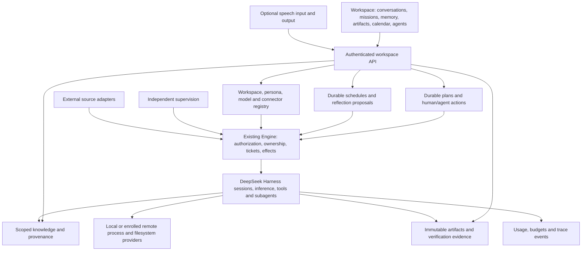

# Agentic OS

The objective is a complete personal agentic workspace: persistent goals, conversations, shared memory, artifacts,
specialist agents, scheduled work, execution control, and operational visibility. DeepSeek Harness remains the execution
runtime. This extends the article implementation tracker in `IMPLEMENTATION.md`, preserving its full scope.

## Foundation decision

Build in `jonsutton86/dsh-superagent-prototype`, retaining its Engine, Harness sessions, SQLite store, durable effects,
admission, worker isolation, and independent supervision. Kun has a substantial Electron workbench, but its architecture
uses the bundled Kun runtime. Replacing that runtime while preserving desktop behavior would add a separate migration.
A desktop shell can later attach through a versioned authenticated API.

The product reference is [the Hermes Agentic OS walkthrough](https://www.youtube.com/watch?v=zqUdtL5l9yM). Its transcript
describes mission control, shared context, personas, cost visibility, overnight reflection, onboarding, and an artifact
library. These are requirements and inspiration, not evidence that this fork implements them. No course code/assets are
included. The [local-model walkthrough](https://www.youtube.com/watch?v=bc7QaDmLmoA) also motivates model selection and voice.

## Complete target architecture

Execution continues through the Engine. UI state, model text, and imported documents cannot independently grant authority
or mark verified completion. Shared context has source/workspace boundaries. Remote file and process operations must
refer to the same environment. Remote access requires authentication; do not expose the current loopback API publicly.

## Implementation ledger

| Requirement | Current evidence | Remaining implementation and acceptance |
| --- | --- | --- |
| Persistent missions | `workspace/service.ts`, SQLite mission/event/command tables, Missions panel, dependency acceptance invalidation | Editable/versioned plans, planner proposals, revisions, multi-workspace ownership |
| Action execution | Operator dispatch into Engine/Harness; runtime and rendered-form tests | Live-provider acceptance, per-action workspace/persona bindings, onboarding independent of GitHub |
| Human participation and completion | Human actions, reviewed dependencies; acceptance bound to ticket, library evidence and direct provenance state | Host-collected check evidence bound to Git/environment revisions; rejected results and revisions |
| Conversations and steering | Harness conversations, mission links, human follow-ups, stop/retry, attempt history | Unified inbox, unread/question indicators and cross-workspace navigation |
| Shared memory and recall | Immutable scoped capsules, typed/hash-bound provenance, FTS search, source freshness/conflict flags, worker tools and library UI | Host-enforced total recall budgets, transitive freshness, measured recall quality, import connectors and multi-workspace ownership |
| Artifact library | Content-addressed publication, search/previews/download, mission/session links, archival and immutable revision history | Large/streamed files, matched-environment imports and directory sync, retention, host verification and external delivery receipts |
| Personas and skills | Harness subagents/tools and prompt configuration | Versioned personas, model preferences, tool scopes, management UI and per-action assignment |
| Schedules and reflection | Existing runtime passes | Persisted occurrences, deduplication, timezone/DST, missed-run policy, budgets and reviewable reflection proposals |
| Usage and budgets | Worker concurrency and health | Provider usage, estimated/reported costs, durable reservations/limits and spend/workload UI |
| Models and connectors | Harness configuration, GitHub/Feishu deployment | Local-first startup without GitHub, workspace enrollment, connector scope and explicit local/cloud data flow |
| Voice | None | Optional input/output adapters, interruption, local/cloud modes and text fallback |
| Supervision and recovery | Watchdog foundation in `009-supervision.md` | Incident UI, live failure tests, restore/failover and remote reconciliation from article tracker |
| Whole-product qualification | Deterministic unit, management API and DOM flows | Browser/desktop layout, actual model/tool acceptance, backup/restart drills, accessibility and packaging |

## Missions increment

The Missions tab creates durable objectives with acceptance criteria, actions assigned to a person or an agent, and
dependencies. Human actions require a result note. Agent actions require explicit dispatch; completed execution enters
review. Acceptance binds the operator's review to the exact execution snapshot. Stopped/dropped execution is not success.
If an accepted result changes later, its acceptance becomes stale; a completed mission is visibly flagged for re-review.
Closing a mission is refused while any action has an open execution.

`workspace` is a built-in source restricted to existing active agent actions. The host mints the operator identity; forms
cannot submit actors, tickets, or execution directories. Endpoints inherit the loopback host/origin/header guard. Disabling
the source prevents new admission and mandate revalidation. This is a local single-owner boundary, not multi-user auth.

Every mutation supplies `requestId`; its fingerprint and receipt commit with the mission, Engine changes, and queued effects.
Identical retries return current state without repeating an effect; changed payloads using the same ID are refused. Revisions
prevent lost updates. Dependencies refer only to earlier actions, preventing cycles. Missions permit at most 200 actions;
lists are paginated, and the activity view reads the latest 100 entries while older activity remains in SQLite.

| API relative to `/orchestrator/api/` | Purpose |
| --- | --- |
| `GET missions?offset=0&limit=30` | Paginated missions |
| `POST missions` | Create title, objective and acceptance criteria |
| `GET missions/:id` | Mission, current execution states and recent activity |
| `POST missions/:id/actions` | Add action/dependencies against a revision |
| `POST missions/:id/actions/:action` | Run, steer, stop, retry or accept |
| `PUT missions/:id` | Complete, archive or reopen against a revision |

Planning works while deployment needs configuration. Execution currently requires the existing configured single-repository
deployment and uses its preparation/delivery rules. This is an integration milestone, not standalone general-purpose
execution. Tests use a simulated Harness host/provider; they do not prove a live deployment or full product completion.

## Verification record

2026-11-08: `pnpm check` passed TypeScript checking, all 64 test files / 1,233 tests, and the server/client bundle builds
on Node 25.9.0. Twelve tests were added, including a rendered create/dispatch/review/complete flow through the management
routes and Harness adapter. Other coverage checks request replay after reopening SQLite, rollback, conflicting revisions,
dependency ordering and invalidation, human steering, source disablement, and stale review rejection.

2026-11-08, library increment: `pnpm check` passed TypeScript, all 66 test files / 1,249 tests, and server/client builds.
Sixteen tests were added for library persistence, scope boundaries, provenance, integrity, review freshness, API integration,
rendered revision/archive flows and a worker-produced HTML artifact preview. Original orchestration prompt-size budgets
remain unchanged; new library tools have separate ceilings of 2,200 router / 4,500 worker characters.

The `dsh` CLI is not installed in this environment. No live provider, unattended deployment, or real-browser visual
acceptance is claimed. The next implementation can proceed without those credentials; whole-product completion cannot.

## Next implementation order

The durable memory/artifact increment is described in `011-library.md`; its application-level scope boundary does not
replace the article's isolated execution environments. It uses the existing SQLite database and Harness tool registration.

1. Local missions without mandatory GitHub setup: workspace roots, general-task prompt profiles, preserved GitHub behavior,
   and a real configured Harness profile.
2. Integrated workspace shell and conversation inbox; richer imports, large-file support and recall budgets over the library.
3. Persona/skill management, durable schedules, budgeted reflection proposals and usage reporting.
4. Article requirements: remote execution, recall, speculation, verification, recovery; optional voice.
5. Actual model/tool user flows, process restarts, restore drills and browser/desktop acceptance. Record supported provider/OS
   combinations and audit every row above before declaring the goal achieved.
