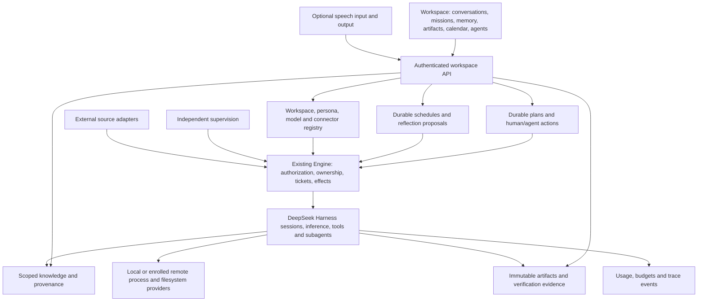

# Agentic OS

The objective is a complete personal agentic workspace: persistent goals, conversations, shared memory, artifacts,
specialist agents, scheduled work, execution control, and operational visibility. DeepSeek Harness remains the execution
runtime. This extends the article implementation tracker in `IMPLEMENTATION.md`, preserving its full scope.

## Foundation decision

Build in `jonsutton86/dsh-superagent-prototype`, retaining its Engine, Harness sessions, SQLite store, durable effects,
admission, worker isolation, and independent supervision. Kun has a substantial Electron workbench, but its architecture
uses the bundled Kun runtime. Replacing that runtime while preserving desktop behavior would add a separate migration.
A desktop shell can later attach through a versioned authenticated API.

The product reference is [the Hermes Agentic OS walkthrough](https://www.youtube.com/watch?v=zqUdtL5l9yM). Its transcript
describes mission control, shared context, personas, cost visibility, overnight reflection, onboarding, and an artifact
library. These are requirements and inspiration, not evidence that this fork implements them. No course code/assets are
included. The [local-model walkthrough](https://www.youtube.com/watch?v=bc7QaDmLmoA) also motivates model selection and voice.

## Complete target architecture

Execution continues through the Engine. UI state, model text, and imported documents cannot independently grant authority
or mark verified completion. Shared context has source/workspace boundaries. Remote file and process operations must
refer to the same environment. Remote access requires authentication; do not expose the current loopback API publicly.

## Implementation ledger

| Requirement | Current evidence | Remaining implementation and acceptance |
| --- | --- | --- |
| Persistent missions | Durable goals, editable/versioned plans, scoped planner proposals, operator review, immutable history, and transitive result invalidation | Multi-workspace ownership, plan-history retention and broader planning-quality evaluation |
| Action execution | Operator dispatch into Engine/Harness; local and repository modes; unit/DOM flows, actual DeepSeek Flash missions, exact per-action persona versions and managed-world selection | Broader provider/tool acceptance, remote repository workflows and guided onboarding |
| Human participation and completion | Human actions, reviewed dependencies; acceptance bound to ticket, library evidence and direct provenance state | Host-collected check evidence bound to Git/environment revisions; rejected results and revisions |
| Conversations and steering | Unified inbox, durable read receipts, question/review filters, visible Harness text, atomic task creation, idempotent replies and mission/artifact links | Cross-workspace enrollment, large-history indexing/retention, attachments and richer conversation tooling |
| Shared memory and recall | Immutable scoped capsules, typed/hash-bound provenance, FTS search, bounded transitive freshness, complete review dependency closure, durable retrieval allowances and chain reads, worker tools and library UI (`043-chain-recall.md`) | Measured retrieval quality and long-horizon workloads, external-source freshness/import connectors, model-token-aware context selection, retention/scaling and multi-workspace ownership |
| Artifact library | Content-addressed publication, search/previews/download, mission/session links, archival, immutable revisions and reviewed GitHub comment delivery with persistent receipts | Large/streamed files, matched-environment imports and directory sync, retention, host verification and broader channel/repository delivery |
| Personas and skills | Immutable versioned definitions, model preferences, optional-tool guards, embedded skills, management UI, reviewed per-action assignment and worker/descendant resume binding; contract in `021-personas.md` | Multi-workspace ownership, stronger per-capability execution boundaries, role-quality evaluations and catalog retention |
| Schedules and reflection | Versioned schedules, durable occurrences, timezone/DST, missed-run/run/open limits, scoped model budgets, bounded automatic reflection snapshots, reviewed memory/plan/new-mission proposals and operator UI (`044-scheduled-reflection.md`) | Reflection quality and long-horizon evaluation, broader provider budget acceptance, retention/scaling, multi-workspace ownership and broader deployment acceptance |
| Usage and budgets | Worker concurrency, schedule run/open-mission reservations, managed Harness call/token ledger, versioned estimated pricing, scoped call/token/spend reservations, reconciliation and operator UI (`042-usage-budgets.md`) | Broader provider/adapter acceptance, invoice import, metadata generation binding, non-token fees, speculative admission integration, retention and multi-workspace ownership |
| Models and connectors | Harness configuration, optional GitHub/Feishu, local grants, authenticated remote transport, paired Harness services, persistent remote authority/revocation and native Linux namespace/cancellation CI, whole-profile and per-action world binding, durable command/file ownership and operator receipts, endpoint-owned versioned credentials, real model artifact/restart qualification, endpoint enrollment/reconciliation and independent managed worlds | Managed endpoint/runtime launch, cross-host deployment qualification and connector scope |
| Voice | None | Optional input/output adapters, interruption, local/cloud modes and text fallback |
| Supervision and recovery | Watchdog foundation, encrypted checkpoints/held Session import, checkpoint-bound claimant replacement, revision-bound independent receipt audits and authenticated held execution/administrative receipt application, ownership authority, endpoint and artifact/mission publication fencing and owned Runtime/dedicated/managed provider lifecycle | Authoritative input/state recovery, private credential/runtime configuration validation, remapping, inbound connector/repository integration, clean-host activation/failover, incident UI and broader live failure tests |
| Whole-product qualification | Deterministic unit, API/DOM flows, actual Harness restarts, live local model/tool, inbox and planner-to-execution missions | Browser/desktop layout, broader provider acceptance, backup/restore drills, accessibility and packaging |

## Missions increment

The Missions tab creates durable objectives with acceptance criteria, actions assigned to a person or an agent, and
dependencies. Human actions require a result note. Agent actions require explicit dispatch; completed execution enters
review. Acceptance binds the operator's review to the exact execution snapshot. Stopped/dropped execution is not success.
If an accepted result changes later, its acceptance becomes stale; a completed mission is visibly flagged for re-review.
Closing a mission is refused while any action has an open execution.

`workspace` is a built-in source restricted to existing active agent actions. The host mints the operator identity; forms
cannot submit actors, tickets, or execution directories. Endpoints inherit the loopback host/origin/header guard. Disabling
the source prevents new admission and mandate revalidation. This is a local single-owner boundary, not multi-user auth.

Every mutation supplies `requestId`; its fingerprint and receipt commit with the mission, Engine changes, and queued effects.
Identical retries return current state without repeating an effect; changed payloads using the same ID are refused. Revisions
prevent lost updates. Added actions depend on existing actions; complete plan proposals validate the whole dependency graph
and reject cycles. Missions permit at most 200 actions;
lists are paginated, and the activity view reads the latest 100 entries while older activity remains in SQLite.

| API relative to `/orchestrator/api/` | Purpose |
| --- | --- |
| `GET missions?offset=0&limit=30` | Paginated missions |
| `POST missions` | Create title, objective and acceptance criteria |
| `GET missions/:id` | Mission, current execution states and recent activity |
| `POST missions/:id/actions` | Add action/dependencies against a revision |
| `POST missions/:id/actions/:action` | Run, steer, stop, retry or accept |
| `PUT missions/:id` | Complete, archive or reopen against a revision |

Planning works while deployment needs configuration. Execution supports the configured single-repository deployment or
a standalone local profile without GitHub. `012-local-execution.md` documents local setup, task directories, prompt profiles,
mode-change protection and the filesystem/process check. Local mode keeps the same Engine, worker Sessions, publication
and review path. It does not supply OS isolation, remote environment enrollment or full product completion.

## Verification record

2026-11-08: `pnpm check` passed TypeScript checking, all 64 test files / 1,233 tests, and the server/client bundle builds
on Node 25.9.0. Twelve tests were added, including a rendered create/dispatch/review/complete flow through the management
routes and Harness adapter. Other coverage checks request replay after reopening SQLite, rollback, conflicting revisions,
dependency ordering and invalidation, human steering, source disablement, and stale review rejection.

2026-11-08, library increment: `pnpm check` passed TypeScript, all 66 test files / 1,249 tests, and server/client builds.
Sixteen tests were added for library persistence, scope boundaries, provenance, integrity, review freshness, API integration,
rendered revision/archive flows and a worker-produced HTML artifact preview. Original orchestration prompt-size budgets
remain unchanged; new library tools have separate ceilings of 2,200 router / 4,500 worker characters.

2026-11-08, local execution increment: `pnpm check` passed TypeScript, all 67 test files / 1,256 tests, and server/client
builds. Tests cover a general mission with no accounts, filesystem/process mismatch and cleanup, mode mismatch, local
prompt tool names, disabled repository preparation, and UI mode saves through the Harness configuration form.

An isolated installation of `@deepseek-ai/dsh@0.2.1-rc.3` started the actual built bundle in local mode. Its loopback API
created a mission and artifact; both identities, content/hash and idempotency receipts survived a real process restart.
After the operator configured the DeepSeek provider, an actual `deepseek-official/deepseek-flash` worker computed
sum/mean values, created and checked a local JSON file, published its exact bytes and reported ready. An independent
file/content/hash check passed, then explicit API review accepted the action and completed the mission. See
`012-local-execution.md` for the artifact hash and qualification limits. Browser/desktop acceptance remains outstanding.

2026-11-08, inbox increment: `pnpm check` passed TypeScript, all 69 test files / 1,267 tests, and server/client builds.
Eleven tests were added for atomic task creation, exact read receipts, question/reply flow, ambiguous-response replay,
visible text projection, history paging, result follow-ups and cancellation while paused. The latter remains stoppable
through both mission and execution controls, cannot be accepted or archived while queued, and never resumes or reroutes
after explicit cancellation. Existing live-ticket handback behavior is unchanged.

The actual DeepSeek worker asked a format question, received its answer through the inbox, computed a JSON summary and
published it. A follow-up resumed the same ticket and produced a second artifact with a `supersedes` link. Independent
file/content/hash checks passed before explicit acceptance and mission completion. A real Harness restart preserved all
eight projected messages, read state, mission acceptance, artifact bytes/hash and both reply replay receipts; no additional
assignment was created. See `013-inbox.md` for the qualification evidence and remaining projection limits. Browser and
desktop acceptance remain outstanding.

2026-11-08, mission planning increment: `pnpm check` passed TypeScript, all 71 test files / 1,278 tests, and server/client
builds. Eleven new tests cover version history, review replay, dependency validation, migration preserving accepted results,
planner rollback, active/paused-work protection, scope, historical restoration, transitive invalidation and rendered review
flows. Outdated executions are also identified as outdated in the Inbox rather than offered as current review results.

An actual DeepSeek Flash planner submitted a two-action proposal and reported ready without applying or executing it.
The qualification driver inspected and approved the exact proposal, verified that no action started on approval, then
explicitly dispatched its agent action. Independent checks confirmed the JSON values, computed total/count, exact published
bytes and SHA-256. The driver exercised the operator review endpoints to test the dependent human action and mission
completion; this simulated review is not a claim of human inspection. A real process restart preserved the three plan
versions, approved proposal, completed actions and artifact hash. Replaying planning, approval and dispatch requests created
no extra assignment. `014-mission-plans.md` records identities and evidence. Broader planning quality and browser acceptance
remain outstanding.

## Next implementation order

The durable memory/artifact increment is described in `011-library.md`; its application-level scope boundary does not
replace the article's isolated execution environments. It uses the existing SQLite database and Harness tool registration.

1. Persistent state ownership, checkpoint/backup restore and failover that preserve Harness Sessions, world authority and original effect receipts.
2. Managed endpoint/machine deployment, remote repository workflows, quotas and host-verified artifacts.
3. Speculative reservations/expiry/promotion, richer imports and large files, retrieval/reflection quality and long-horizon
   evaluation, broader provider accounting and retention. Recall budgets, transitive freshness, schedules, reviewed reflection
   and usage reporting now have implementation evidence; multi-workspace ownership and optional voice remain in scope.
4. Supervision and incident UI, actual model/tool user flows, process/host failure, restore drills, packaging and browser/desktop acceptance. Record supported provider/OS
   combinations and audit every row above before declaring the goal achieved.

Local environment increment: `015-execution-environments.md` records paired filesystem/process verification, persisted task grants,
explicit changed-root enrollment, revoke/reauthorize/replace controls, and mutation replay after response loss. These local
authorization generations do not implement remote leases or OS isolation. The full remote requirement remains open.

2026-11-08, environment qualification: `pnpm check` passed all 73 files / 1,294 tests and builds. The live Harness/DeepSeek
provider path exercised a generation-1 question, revocation and refused admission, generation-3 artifact production, byte/hash
verification, and restart/replay with no duplicate assignments. The new artifact remains for operator review; this was a
qualification driver, not a claim of human acceptance. `015-execution-environments.md` records identities and limits.

Endpoint administration increment: `020-endpoint-administration.md` records pinned endpoint registration, durable original-ID administration, grant/credential controls, explicit reconciliation and generated dedicated Harness profiles. The subsequent persona and managed-world increments add exact per-action routing; managed machine/endpoint launch remains open.

Managed-world increment: `022-managed-worlds.md` records the independent registry, paired preset scopes, per-action selection,
world lifecycle and restart contract. Code `cecfde32924209bca220bcf01fd9ac3b28aedabd` passed 1,376 local tests and both
separate configured-model Harness cases, including delegated work, isolated revocation and continuation after restart.
The same code passed 1,378 tests and all three native confinement cases in
[Linux run 42528377954](https://github.com/jonsutton86/dsh-superagent-prototype/actions/runs/42528377954).

Checkpoint increment: `023-checkpoint-recovery.md` records encrypted offline capture, complete verification, held staging and
retryable Harness Session import. Activation remains unavailable until exclusive ownership, stale-owner fencing and remote
receipt reconciliation are enforced. The full persistent ownership and clean-host failover requirement remains open.

Checkpoint qualification: code `aef82a2ce95666a58cd7892487d3bb3e0ab35175` passed 1,386 local tests and both installed-Harness
model cases extended through maintenance capture, verification, staging and repeated fresh-backend imports. It also passed
1,388 tests with native confinement enabled in
[Linux run 42531703951](https://github.com/jonsutton86/dsh-superagent-prototype/actions/runs/42531703951).
These results qualify the staged recovery increment; they do not complete ownership activation or failover.

Ownership increment: `024-ownership-fencing.md` records independent ownership acquisition, all-resource preparation,
monotonic lease expiry, endpoint cancellation/reconciliation barriers and paired-world handoff with original receipt
generations. Existing workspace grants retain their identity. Runtime/managed-pool and publication integration remain open,
as do clean-host activation and failover drills; the recovery hold is unchanged.

Ownership qualification: code `7e2a33cc4ff662188eee52417056900b4c21e0c4` passed 1,400 local tests, both installed-Harness
cases (including the independent authority process restart/handoff), and 1,402 Linux tests in
[run 42535557440](https://github.com/jonsutton86/dsh-superagent-prototype/actions/runs/42535557440). Typechecking and all
four builds passed. Those model cases qualified existing coordinator workflows. The subsequent Runtime increment in
`025-runtime-ownership.md` connects managed and dedicated providers to a shared process lease, stops work on loss and
refuses unfenced local execution. Publication integration and restored activation remain open.

Runtime qualification: code `ba17edd5fe09d9276b8d27168188f7f6d9b83abe` passed 1,406 local tests, all four installed
Harness model scenarios, and 1,408 tests with native confinement in
[Linux run 42537715231](https://github.com/jonsutton86/dsh-superagent-prototype/actions/runs/42537715231).
Typechecking and all builds passed. The full product goal remains in progress.

Artifact delivery increment: `026-artifact-publication.md` adds an independent Harness publication service, exact
artifact/destination approval, private account credentials, durable original-ID receipts and unknown-outcome ownership
barriers. The library UI reviews full text and recovers original requests. Feishu, Source Outbox and repository mutations,
automatic mandate-based publication, host verification and restored-state activation remain in the implementation ledger.

Artifact delivery qualification: code `fd058c95ad6046751fd0429a6046c1bb1e151316` passed 1,418 local tests, both owned
installed-Harness model scenarios including the separate publication plugin, and 1,420 native Linux tests in
[run 42540908750](https://github.com/jonsutton86/dsh-superagent-prototype/actions/runs/42540908750).
Typechecking and all four builds passed. No real external messages were sent during qualification.

Mission delivery increment: `027-mission-delivery.md` adds plan-bound standing consent, worker/router replies through the
existing Outbox, immutable original intents and unknown receipt recovery after revocation, withdrawal or ownership loss.
GitHub review and Feishu/Lark root replies extend the independent service. Owned inbound connectors, repository mutations,
live tenant/account qualification, host verification and restored activation/failover remain open.

Mission delivery qualification: code `3bf6a280f992c2e8621f6ec388879785f7827598` passed 1,437 local tests and both owned
installed-Harness/DeepSeek Flash scenarios. It also passed 1,439 native Linux tests, typechecking and all four builds in
[run 42543761724](https://github.com/jonsutton86/dsh-superagent-prototype/actions/runs/42543761724).
Provider traffic stayed on synthetic local servers; this is implementation evidence, not a live-account deployment claim.

Inbound conversation increment: `028-inbound-conversations.md` adds explicit participant/task bindings, independently fenced
provider reads, atomic Engine admission, durable cursors and native deduplication. The mission panel controls consent,
rescan and pause, and shows unsupported messages. Replies remain restricted to the original task through routing and worker
context access. Repository-wide discovery and admission, rich content, Git/PR mutations, retention, live-account acceptance
and restored-state activation remain required; this increment does not complete the full architecture.

Inbound qualification: code `a558cdd5f6bf2de59512afb60373cff2465fb74b` passed 1,457 local tests and both owned
installed-Harness/DeepSeek Flash scenarios, including actual task resumption and acknowledgement from a provider reply,
artifact preservation, restart and native-message deduplication. It also passed 1,459 native Linux tests, typechecking and
all builds in [run 42546908912](https://github.com/jonsutton86/dsh-superagent-prototype/actions/runs/42546908912).
Provider traffic remained local; live tenant/account acceptance and the broader product requirements remain open.

Recovery reservation increment: `029-recovery-reservations.md` binds independent claimant replacement to the exact
authenticated held checkpoint. The original installation loses acquisition authority; durable original requests survive
response loss and private-file failures without silently rotating again or adopting a newer reservation. Selected process
clients still require the resource barrier. Maintenance retains the execution hold. Receipt reconciliation, post-checkpoint
divergence, configuration remapping, activation and clean-host failure drills remain required.

Recovery reservation qualification: code `6d2ef214431d030c82ba2174f5e52ecc10b5acef` passed 1,468 local tests, both owned
installed-Harness/DeepSeek Flash scenarios (199.31 seconds), and 1,470 native Linux tests in
[run 42549125311](https://github.com/jonsutton86/dsh-superagent-prototype/actions/runs/42549125311).
Typechecking and all four builds passed. Real checkpoint reservation/retry retained the restore hold and invalidated the
source claimant; provider traffic remained local. The full article and Agentic OS architecture remain in progress.

Recovery audit increment: `030-recovery-receipt-audit.md` compares authenticated original intents against complete enrolled
endpoint and publisher inventories with mutation/restart revision checks. Durable reports expose missing, changed, unknown
and unrecorded effects, while repeated inspection observes original outcomes without replay or activation. Applying those
observations, input/state recovery, administrative-command/configuration reconciliation, Session/backend and world validation,
activation and clean-host failover remain required alongside the full product ledger.

Recovery audit qualification: code `44b3fa54685ee4cf471c5b26db1ccc4c918337ba` passed 1,482 local tests and both owned
installed-Harness/DeepSeek Flash scenarios in 215.31 seconds. Repeated audits covered all original receipts and identified the
four unrecorded publication probes by exact ID while retaining the hold. The same code passed 1,484 native Linux tests,
typechecking and all four builds in
[run 42552272631](https://github.com/jonsutton86/dsh-superagent-prototype/actions/runs/42552272631).
Provider traffic remained local; the full product and restored activation remain in progress.

Held receipt preparation: `031-recovery-receipt-preparation.md` adds administrator-only revision-bound observations and a
separate authenticated recovery image, preserving source state and execution holds. Original command/file outcomes and
artifact/channel receipts are applied without replay, with original-ID retries and Outbox settlement. Administrative and
configuration reconciliation, authoritative input/state recovery, actual Session validation, remapping, activation and
clean-host failure qualification remain open alongside the full product ledger.

Receipt-preparation qualification: code `66b28a49f5a81dc08c6c5f19b0d31a5cfb66ba1e` passed 1,495 local tests, both
owned installed-Harness/DeepSeek Flash cases, and 1,497 tests with native confinement in
[Linux run 42554537411](https://github.com/jonsutton86/dsh-superagent-prototype/actions/runs/42554537411). Typechecking
and all four builds passed. Managed recovery prepared the same held image twice; the dedicated case refused unrecorded
publication effects. The original app remained running and no restored activation was performed.

Administrative recovery: `032-administrative-recovery.md` extends audit/preparation to original grant, credential,
cancellation and reconciliation commands without resending them. Recovered grant records cannot activate before private
credential validation; later generations/versions are not substituted for historical results. Active-world credential
version/status comparisons detect rotation and revocation. The execution hold and the remaining full architecture ledger
stay in place, including authoritative input/state recovery, configuration validation, Session/world remapping and activation.

Administrative-recovery qualification: code `3f2d4ba2ee7058fc8f037fb4c666e074b8ac3ca3` passed 1,508 local tests,
typechecking and all four builds. Both owned installed-Harness / DeepSeek Flash cases passed in 201.96 seconds, including
managed subagent work and authenticated administrative receipt preparation. The live run exposed and regression tests
reproduced false abandoned-command refusals; providers now share live command ownership within one world and retain that
ownership through delayed catalog observations. Unknown dispatch still fences siblings until receipt reconciliation.
The same code passed 1,510 tests with native confinement, typechecking and all builds in
[Linux run 42558234881](https://github.com/jonsutton86/dsh-superagent-prototype/actions/runs/42558234881).
The original app remained running. Provider-message traffic stayed local; restored activation and the full product remain open.

Original world revocation recovery: `033-revocation-recovery.md` adds read-only historical grant-principal receipt checks,
exact disabled-successor binding validation and separate original-generation quiescence observation. Missing or conflicting
proof blocks recovery; confirmed acknowledgements are applied only to held world copies without replay. Original source
state, old grant identity and all execution holds remain intact. Private configuration, input/state recovery, Session/backend
validation, remapping, activation and the broader article/product ledger remain open.

Revocation-recovery qualification: `8c1a66445b89b328ebcbdad61260b147505a10a2` passed 1,521 local tests, typechecking,
all four builds and both owned installed-Harness / DeepSeek Flash scenarios in 195.07 seconds. Managed recovery confirmed
the original lost revocation without another revocation request, preserved the held source and authenticated repeated
preparation. The same code passed 1,523 tests with native confinement, typechecking and all builds in
[Linux run 42559418182](https://github.com/jonsutton86/dsh-superagent-prototype/actions/runs/42559418182).
Provider-message traffic stayed local; the original app remained running. This does not qualify restored activation.

Execution configuration recovery: `034-execution-configuration-recovery.md` validates each active world's original grant
credential, managed private pin, root identity and private endpoint credential snapshots. Audit and preparation recheck private
files before finalizing; no work is dispatched, credentials renewed or authority acquired. Confirmed revoked worlds remain
non-executable without requiring retired files. Broader runtime/private configuration, account permissions, authoritative state,
Session-backend validation, remapping and activation remain required.

Execution-configuration qualification: `ea66ba2384e1a82da2f24401ab3f3e93f13368b0` passed 1,544 local tests,
typechecking and all four builds. Both owned installed-Harness / DeepSeek Flash scenarios passed in 193.93 seconds,
including original private credential checks for an active world while retaining and reconciling two revoked worlds.
The same code passed 1,546 tests with native confinement, typechecking and all builds in
[Linux run 42561413655](https://github.com/jonsutton86/dsh-superagent-prototype/actions/runs/42561413655).
Provider-message traffic stayed local; the original app remained running. Broader configuration and activation remain open.

Destination Session recovery: `035-session-backend-recovery.md` adds mandatory verification against the maintenance profile's
actual imported Harness backend. It claims selected writers, compares immutable headers, inherited boundaries and exact
logical events, rejects newer/divergent/short/missing history, and rechecks related descendants before held publication.
Signed images record only Session/event counts. No history is repaired, no hold is removed, and historical retry evidence
does not authorize activation. Runtime/account configuration, authoritative state, remapping, coordinated live ownership
handoff, clean-host failure qualification and the full article/product ledger remain open.

Destination-Session code `915cfc28f6b2ca10425a185376f85ae3d3c6b4e0` passed 1,562 local tests, typechecking and all
four builds. The focused recovery run passed 108 tests, and the complete suite also covers older manifests without the new
Session summary. Authentication of historical evidence does not clear a recovery hold.
Both owned installed-Harness / DeepSeek Flash scenarios passed in 192.86 seconds, including preparation against the separately
imported destination and signed Session/event counts. Linux passed 1,564 tests with native confinement, typechecking and all
builds in [run 42562981301](https://github.com/jonsutton86/dsh-superagent-prototype/actions/runs/42562981301).
Provider-message traffic stayed local; the original app remained running. Broader configuration and activation remain open.

Control configuration recovery: `036-control-configuration-recovery.md` adds read-only proof of the reserved claimant and
the coordinator's publisher credential. It checks pinned provider account identity and target access at the audited revision,
repeats private-file checks before publishing, and records only safe successful check counts. No lease or message is created.
Inference/source configuration, authoritative state, remapping, coordinated activation and clean-host failure qualification
remain required alongside the complete article/product scope.

Control-configuration code `56adf6dc2243fe40e41b8491a885623293a77762` passed 1,591 local tests, typechecking and all
four builds. Focused recovery and ownership/publication runs passed 92 and 43 tests respectively.
The same code passed 1,593 tests with native Linux confinement, typechecking and all builds in
[run 42564344905](https://github.com/jonsutton86/dsh-superagent-prototype/actions/runs/42564344905).
Both owned installed-Harness / DeepSeek Flash scenarios passed in 224.07 seconds, including actual reserved-claimant and
coordinator-publisher authentication, provider account/target preflight and the signed control summary in held preparation.
Provider-message traffic stayed local; the original app remained running. Broader configuration, authoritative state and
restored activation remain open.

Inference configuration recovery: `037-inference-configuration-recovery.md` makes new held preparation check effective
Session, queued persona and role model routes through Harness. Bounded history-free inference probes run before preparation
and before publication; safe signed evidence records counts and configuration digests. Failures preserve the execution hold.
These are observations of the selected restore host's inference path, including its middleware, not proof of uncaptured
source-host settings or future availability. Source/connector configuration, authoritative state, remapping, restored activation
and clean-host failover remain open alongside the full article/product scope.

Inference-recovery code `891a31394a55825ab5d24c8eff2e8f858344f4ca` passed 1,616 local tests, typechecking and all four builds.
The same code passed 1,618 tests with native Linux confinement, typechecking and all builds in
[run 42567837206](https://github.com/jonsutton86/dsh-superagent-prototype/actions/runs/42567837206).
Both owned installed-Harness / DeepSeek Flash scenarios passed in 206.52 seconds. Managed recovery used the real
Session Controller projection and provider path, verified the signed inference summary, and retrieved its original held
image on retry. The dedicated case retained its expected refusal for unrecorded publication probes. Provider-message
traffic stayed local; the original app remained running. Source configuration, authoritative state and restored activation
remain open.

Consumed input recovery: `038-consumed-input-recovery.md` reconciles missing live read/queue acknowledgements against
authenticated worker history, only in the private held image. Inherited messages, foreign producer identities and
queued/claimed/canceled inbox events are not consumption proof. Contradictory read markers and duplicate identities fail;
later failures or cancellation roll back earlier repairs. Signed counts preserve historical retries and older image support.
Ended outcomes and original authority stay unchanged. Source configuration, pending-work/broader state reconciliation,
runtime remapping, supported activation and clean-host failover remain open with the full article/product scope.

Consumed-input recovery code `679a97ad8f290f060c07a332ba4de3a0bad690f7` passed 1,640 local tests, typechecking and all
four builds. The same code passed 1,642 tests with native Linux confinement, typechecking and all builds in
[run 42570416549](https://github.com/jonsutton86/dsh-superagent-prototype/actions/runs/42570416549).
Both owned installed-Harness / DeepSeek Flash scenarios passed in 197.68 seconds. Managed recovery verified the signed
consumption summary against actual worker inputs and returned the same held image on retry; the dedicated case retained
its expected refusal for unrecorded publication probes. The focused recovery/delivery run passed 133 tests. Provider-message
traffic stayed local and the original app remained running. Source configuration, broader authoritative-state reconciliation,
supported activation and the remaining full architecture/product requirements remain open.

Passive source recovery: `039-source-contract-recovery.md` separates loaded source contracts from polling and coordinator
startup. New held preparation validates source/policy settings against the actual maintenance catalog and shared owned-mode
eligibility, records signed counts/digests, and rejects catalog reloads or changed settings/defaults before final publication.
Unknown explicitly disabled sources remain opaque; invalid or required missing contracts fail held. This does not establish
uncaptured plugin versions, private connector accounts or successful polling. Actual deployment binding, broader state/cursor
reconciliation, remapping, restored activation and the remaining full article/product scope remain open.

Source-contract code `24fe27f7e172d40e2f47e03c618ced6e2e0c9bca` passed 1,656 local tests, typechecking and all four
builds. The same code passed 1,658 tests with native Linux confinement, typechecking and all builds in
[run 42572760163](https://github.com/jonsutton86/dsh-superagent-prototype/actions/runs/42572760163).
Both owned installed-Harness / DeepSeek Flash scenarios passed in 202.70 seconds. Managed recovery loaded the bundle's
passive source catalog with the coordinator disabled, verified its signed source summary, and retrieved the same held image
on retry. The dedicated case retained its expected refusal for unrecorded publication probes. Focused source/recovery tests
passed 184 cases; bundle tests passed all three cases after their expected plugin list was updated. Provider-message traffic
stayed local and the original app remained running. Deployment binding, authoritative pending-work/cursor reconciliation,
supported activation, clean-host failover and the remaining architecture/product scope remain open.

Pending input recovery: `040-pending-input-recovery.md` extends delivery/read provenance to every current input kind,
requeues accepted unread work on restart/retry, and preserves the held-automation rule beside settled reports. A delivery
retry that finds consumed history now repairs its Store acknowledgement without sending again. Held image reconciliation
also checks non-trigger read markers. Legacy delivery ambiguity, broader state and cursor reconciliation, deployment
binding, supported activation, clean-host failover and the remaining full architecture/product scope remain open.

Pending-input code `bc50b29cd3eccbf41c667e25d5cb62a3e75f9943` passed 1,665 local tests, typechecking and all four
builds; the focused run passed 224 tests. The same code passed 1,667 tests with native Linux confinement, typechecking
and all builds in [run 42575419242](https://github.com/jonsutton86/dsh-superagent-prototype/actions/runs/42575419242).
Both owned installed-Harness / DeepSeek Flash scenarios passed in 213.61 seconds. Managed recovery confirmed original
Store non-trigger read acknowledgements against authenticated worker history and preserved original-ID image retries.
The dedicated case retained its expected unrecorded-publication refusal. Channel traffic stayed on fixture servers and
the original app remained running. Full activation, failover and the remaining architecture/product scope remain open.

Persistent schedules: `041-schedules.md` adds complete mission-plan snapshots, durable occurrence/run reservations,
calendar/interval/one-off timing, DST handling, missed-run policies, run/open-mission limits and a bilingual operator page.
Standing-authorization triggers remain distinct from new human messages; human actions and reviewed dependencies keep
their existing gates. Schedule code `a9371423fb5b12c63a430fb7e42aef7829e60128` passed 1,679 local tests, typechecking
and all builds, and 1,681 tests with native Linux confinement plus typechecking/builds in
[run 42578515463](https://github.com/jonsutton86/dsh-superagent-prototype/actions/runs/42578515463).
Both owned installed-Harness / DeepSeek Flash scenarios passed in 235.73 seconds. A disabled schedule survived restart,
its enabled occurrence produced independently checked file/artifact bytes, and a later restart preserved exactly one run
and assignment. The focused run passed 40 tests. The original app remained running. Reflection proposals, spend accounting,
multi-workspace ownership, restored activation, voice, packaging and the remaining full architecture/product scope stay open.

Managed usage: `042-usage-budgets.md` adds durable managed Harness calls and provider-reported tokens, explicit versioned
prices, conservative scoped reservations, uncertain-call reconciliation and a bilingual usage/limits surface. Mission,
schedule and persona pages link to their limits. Costs remain estimates; invoice import, prepared-generation metadata,
non-token fees, speculative admission integration, retention and multi-workspace ownership remain open.
Accounting code `fd6b18542dea7df48a5ff1d67b1f50e9c7424118` passed 1,693 Linux tests with typechecking/builds in
[run 42582670631](https://github.com/jonsutton86/dsh-superagent-prototype/actions/runs/42582670631).
Local validation passed 1,690 tests and a 27-test final focused run. Both owned installed-Harness / DeepSeek Flash scenarios
passed in 249.58 seconds: real scheduled tokens and ownership survived restart; a scoped limit refused inference before
any admitted call; an explicit retry after disabling that limit completed and reported usage. The original app remained
running. UI follow-up `f9eeb684c73da00cdbff86a170a57c1666affc0c` fixes provider-specific price editing and passed
eight focused checks, typechecking and all builds without changing the qualified runtime. All other full product and
architecture requirements remain active.
Final code `f9eeb684c73da00cdbff86a170a57c1666affc0c` also passed 1,693 Linux tests, typechecking and all builds in
[run 42583242628](https://github.com/jonsutton86/dsh-superagent-prototype/actions/runs/42583242628).

Chain of Recall: `043-chain-recall.md` replaces the prompt-only recall guideline with durable per-execution/router-day
allowances, atomic reservations, exact output-byte limits and bounded scoped graph reads. Source freshness follows
transitive dependencies and reports incomplete checks as unknown. Mission review hashes the complete accessible source
closure; distant changes invalidate acceptance even beyond the bounded display depth. Artifact publication refuses stale,
contested or unknown chains. Operator controls expose limits, charges and stale-source navigation.
Code `1aaa87cc87f577345bfb2fd5bc51d7d6f62b48ca` passed 1,708 Linux tests, typechecking and all builds in
[run 42587579793](https://github.com/jonsutton86/dsh-superagent-prototype/actions/runs/42587579793).
The full local check passed 1,704 tests, with 56 passing in the final focused run. Both owned installed-Harness / DeepSeek
Flash scenarios passed in 254.46 seconds. A real worker obtained an exact code through three linked records and retained
its exact retrieval receipts across restart. Usage refusal/retry, scheduled artifact production and held recovery also passed.
The original app remained running. Automatic reflection, retrieval-quality/long-horizon evaluation, external imports and
freshness, retention, multi-workspace, speculative admission, restored activation/failover, voice and all other full product
and architecture requirements remain active.

Scheduled reflection: `044-scheduled-reflection.md` adds bounded selection of recent missions, activity and scoped library
records into immutable pre-dispatch snapshots. Harness workers submit memory, plan-change or new-mission candidates;
operator review checks cited evidence and applies changes transactionally without dispatch. Captured context, omission
counts, proposal review and resulting records are available in the Reflections tab. Private relationship filtering,
durable snapshot-read/proposal limits, active-work protection, restart persistence and exact approval retries are covered.
Code `b53a3fd2d268a23175f85bb024660f4ae5567ec1` passed 1,718 local tests, typechecking and all builds, and 1,720 Linux
tests in [run 42591703174](https://github.com/jonsutton86/dsh-superagent-prototype/actions/runs/42591703174).
Both owned installed-Harness / DeepSeek Flash scenarios passed in 289.10 seconds; the managed-world flow verified a
candidate from captured-only evidence, no direct publication, explicit approval, source/agent provenance and unchanged
snapshots/receipts/dispatch after restart. The original app remained running. Reflection/retrieval quality and long-horizon
evaluation, imports/freshness, retention/scaling, multi-workspace ownership, speculative admission/promotion, managed
machine launch, host-collected verification, recovery activation/failover, supervision, voice, packaging and onboarding
remain in the full implementation scope.

Speculative preparation: `045-speculative-preparation.md` adds durable reservations before execution, actual Harness model
accounting, explicit-work preemption, quiescence and recovery holds, evidence promotion and separate message publication
approval. The original Engine and Harness remain the execution path. Code `6f27667b1d6f6ca4572fbad02e4aa06e830ffdbb`
passed 1,738 local tests and 1,740 Linux tests, typechecking and all builds in
[run 42599700832](https://github.com/jonsutton86/dsh-superagent-prototype/actions/runs/42599700832).
The final installed-Harness / DeepSeek Flash speculative scenario passed in 21.98 seconds, with real file/artifact and
usage evidence, separate promotion/publication decisions and no repeated execution or delivery after restart.
Long-horizon quality, confinement, retention/scaling and all remaining full architecture/product requirements remain active.

Both owned installed-Harness / DeepSeek Flash scenarios passed against the final built artifact in 262.56 seconds,
including managed-world scheduled reflection, usage refusal/retry, artifacts and held recovery. The original app process
remained running. These checks qualify this increment; they do not close the remaining full Agentic OS requirements.
