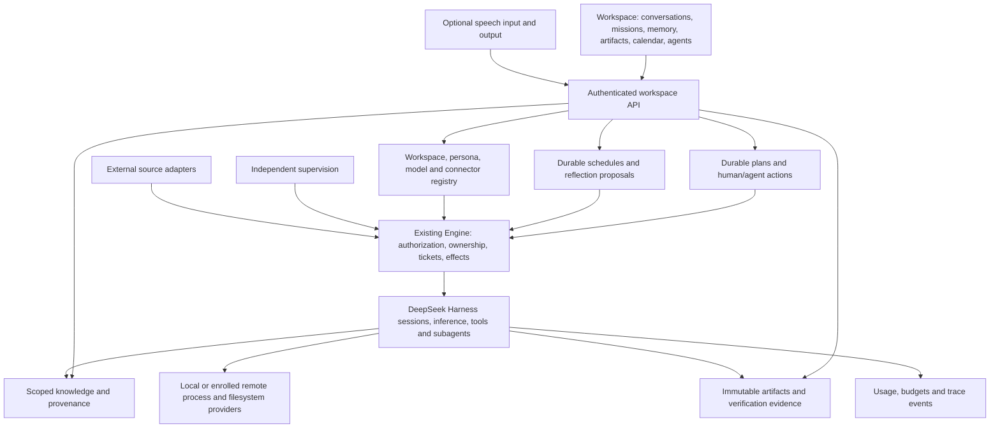

# Agentic OS

The objective is a complete personal agentic workspace: persistent goals, conversations, shared memory, artifacts,
specialist agents, scheduled work, execution control, and operational visibility. DeepSeek Harness remains the execution
runtime. This extends the article implementation tracker in `IMPLEMENTATION.md`, preserving its full scope.

## Foundation decision

Build in `jonsutton86/dsh-superagent-prototype`, retaining its Engine, Harness sessions, SQLite store, durable effects,
admission, worker isolation, and independent supervision. Kun has a substantial Electron workbench, but its architecture
uses the bundled Kun runtime. Replacing that runtime while preserving desktop behavior would add a separate migration.
A desktop shell can later attach through a versioned authenticated API.

The product reference is [the Hermes Agentic OS walkthrough](https://www.youtube.com/watch?v=zqUdtL5l9yM). Its transcript
describes mission control, shared context, personas, cost visibility, overnight reflection, onboarding, and an artifact
library. These are requirements and inspiration, not evidence that this fork implements them. No course code/assets are
included. The [local-model walkthrough](https://www.youtube.com/watch?v=bc7QaDmLmoA) also motivates model selection and voice.

## Complete target architecture

Execution continues through the Engine. UI state, model text, and imported documents cannot independently grant authority
or mark verified completion. Shared context has source/workspace boundaries. Remote file and process operations must
refer to the same environment. Remote access requires authentication; do not expose the current loopback API publicly.

## Implementation ledger

| Requirement | Current evidence | Remaining implementation and acceptance |
| --- | --- | --- |
| Persistent missions | Durable goals, editable/versioned plans, scoped planner proposals, operator review, immutable history, and transitive result invalidation | Multi-workspace ownership, plan-history retention and broader planning-quality evaluation |
| Action execution | Operator dispatch into Engine/Harness; local and repository modes; unit/DOM flows and one actual DeepSeek Flash mission | Broader provider/tool acceptance, per-action workspace/persona bindings and guided onboarding |
| Human participation and completion | Human actions, reviewed dependencies; acceptance bound to ticket, library evidence and direct provenance state | Host-collected check evidence bound to Git/environment revisions; rejected results and revisions |
| Conversations and steering | Unified inbox, durable read receipts, question/review filters, visible Harness text, atomic task creation, idempotent replies and mission/artifact links | Cross-workspace enrollment, large-history indexing/retention, attachments and richer conversation tooling |
| Shared memory and recall | Immutable scoped capsules, typed/hash-bound provenance, FTS search, source freshness/conflict flags, worker tools and library UI | Host-enforced total recall budgets, transitive freshness, measured recall quality, import connectors and multi-workspace ownership |
| Artifact library | Content-addressed publication, search/previews/download, mission/session links, archival and immutable revision history | Large/streamed files, matched-environment imports and directory sync, retention, host verification and external delivery receipts |
| Personas and skills | Harness subagents/tools and prompt configuration | Versioned personas, model preferences, tool scopes, management UI and per-action assignment |
| Schedules and reflection | Existing runtime passes | Persisted occurrences, deduplication, timezone/DST, missed-run policy, budgets and reviewable reflection proposals |
| Usage and budgets | Worker concurrency and health | Provider usage, estimated/reported costs, durable reservations/limits and spend/workload UI |
| Models and connectors | Harness configuration, optional GitHub/Feishu, local grants, authenticated remote endpoint transport and paired remote Harness services | Remote mission/world composition, operator endpoint enrollment, native Linux qualification, per-action environments, endpoint credential bindings and connector scope |
| Voice | None | Optional input/output adapters, interruption, local/cloud modes and text fallback |
| Supervision and recovery | Watchdog foundation in `009-supervision.md` | Incident UI, live failure tests, restore/failover and remote reconciliation from article tracker |
| Whole-product qualification | Deterministic unit, API/DOM flows, actual Harness restarts, live local model/tool, inbox and planner-to-execution missions | Browser/desktop layout, broader provider acceptance, backup/restore drills, accessibility and packaging |

## Missions increment

The Missions tab creates durable objectives with acceptance criteria, actions assigned to a person or an agent, and
dependencies. Human actions require a result note. Agent actions require explicit dispatch; completed execution enters
review. Acceptance binds the operator's review to the exact execution snapshot. Stopped/dropped execution is not success.
If an accepted result changes later, its acceptance becomes stale; a completed mission is visibly flagged for re-review.
Closing a mission is refused while any action has an open execution.

`workspace` is a built-in source restricted to existing active agent actions. The host mints the operator identity; forms
cannot submit actors, tickets, or execution directories. Endpoints inherit the loopback host/origin/header guard. Disabling
the source prevents new admission and mandate revalidation. This is a local single-owner boundary, not multi-user auth.

Every mutation supplies `requestId`; its fingerprint and receipt commit with the mission, Engine changes, and queued effects.
Identical retries return current state without repeating an effect; changed payloads using the same ID are refused. Revisions
prevent lost updates. Added actions depend on existing actions; complete plan proposals validate the whole dependency graph
and reject cycles. Missions permit at most 200 actions;
lists are paginated, and the activity view reads the latest 100 entries while older activity remains in SQLite.

| API relative to `/orchestrator/api/` | Purpose |
| --- | --- |
| `GET missions?offset=0&limit=30` | Paginated missions |
| `POST missions` | Create title, objective and acceptance criteria |
| `GET missions/:id` | Mission, current execution states and recent activity |
| `POST missions/:id/actions` | Add action/dependencies against a revision |
| `POST missions/:id/actions/:action` | Run, steer, stop, retry or accept |
| `PUT missions/:id` | Complete, archive or reopen against a revision |

Planning works while deployment needs configuration. Execution supports the configured single-repository deployment or
a standalone local profile without GitHub. `012-local-execution.md` documents local setup, task directories, prompt profiles,
mode-change protection and the filesystem/process check. Local mode keeps the same Engine, worker Sessions, publication
and review path. It does not supply OS isolation, remote environment enrollment or full product completion.

## Verification record

2026-11-08: `pnpm check` passed TypeScript checking, all 64 test files / 1,233 tests, and the server/client bundle builds
on Node 25.9.0. Twelve tests were added, including a rendered create/dispatch/review/complete flow through the management
routes and Harness adapter. Other coverage checks request replay after reopening SQLite, rollback, conflicting revisions,
dependency ordering and invalidation, human steering, source disablement, and stale review rejection.

2026-11-08, library increment: `pnpm check` passed TypeScript, all 66 test files / 1,249 tests, and server/client builds.
Sixteen tests were added for library persistence, scope boundaries, provenance, integrity, review freshness, API integration,
rendered revision/archive flows and a worker-produced HTML artifact preview. Original orchestration prompt-size budgets
remain unchanged; new library tools have separate ceilings of 2,200 router / 4,500 worker characters.

2026-11-08, local execution increment: `pnpm check` passed TypeScript, all 67 test files / 1,256 tests, and server/client
builds. Tests cover a general mission with no accounts, filesystem/process mismatch and cleanup, mode mismatch, local
prompt tool names, disabled repository preparation, and UI mode saves through the Harness configuration form.

An isolated installation of `@deepseek-ai/dsh@0.2.1-rc.3` started the actual built bundle in local mode. Its loopback API
created a mission and artifact; both identities, content/hash and idempotency receipts survived a real process restart.
After the operator configured the DeepSeek provider, an actual `deepseek-official/deepseek-flash` worker computed
sum/mean values, created and checked a local JSON file, published its exact bytes and reported ready. An independent
file/content/hash check passed, then explicit API review accepted the action and completed the mission. See
`012-local-execution.md` for the artifact hash and qualification limits. Browser/desktop acceptance remains outstanding.

2026-11-08, inbox increment: `pnpm check` passed TypeScript, all 69 test files / 1,267 tests, and server/client builds.
Eleven tests were added for atomic task creation, exact read receipts, question/reply flow, ambiguous-response replay,
visible text projection, history paging, result follow-ups and cancellation while paused. The latter remains stoppable
through both mission and execution controls, cannot be accepted or archived while queued, and never resumes or reroutes
after explicit cancellation. Existing live-ticket handback behavior is unchanged.

The actual DeepSeek worker asked a format question, received its answer through the inbox, computed a JSON summary and
published it. A follow-up resumed the same ticket and produced a second artifact with a `supersedes` link. Independent
file/content/hash checks passed before explicit acceptance and mission completion. A real Harness restart preserved all
eight projected messages, read state, mission acceptance, artifact bytes/hash and both reply replay receipts; no additional
assignment was created. See `013-inbox.md` for the qualification evidence and remaining projection limits. Browser and
desktop acceptance remain outstanding.

2026-11-08, mission planning increment: `pnpm check` passed TypeScript, all 71 test files / 1,278 tests, and server/client
builds. Eleven new tests cover version history, review replay, dependency validation, migration preserving accepted results,
planner rollback, active/paused-work protection, scope, historical restoration, transitive invalidation and rendered review
flows. Outdated executions are also identified as outdated in the Inbox rather than offered as current review results.

An actual DeepSeek Flash planner submitted a two-action proposal and reported ready without applying or executing it.
The qualification driver inspected and approved the exact proposal, verified that no action started on approval, then
explicitly dispatched its agent action. Independent checks confirmed the JSON values, computed total/count, exact published
bytes and SHA-256. The driver exercised the operator review endpoints to test the dependent human action and mission
completion; this simulated review is not a claim of human inspection. A real process restart preserved the three plan
versions, approved proposal, completed actions and artifact hash. Replaying planning, approval and dispatch requests created
no extra assignment. `014-mission-plans.md` records identities and evidence. Broader planning quality and browser acceptance
remain outstanding.

## Next implementation order

The durable memory/artifact increment is described in `011-library.md`; its application-level scope boundary does not
replace the article's isolated execution environments. It uses the existing SQLite database and Harness tool registration.

1. Paired remote execution environments and authenticated endpoints; richer imports, large-file support and enforced recall budgets.
2. Persona/skill management, durable schedules, budgeted reflection proposals and usage reporting.
3. Article requirements: remote execution, recall, speculation, verification, recovery; optional voice.
4. Actual model/tool user flows, process restarts, restore drills and browser/desktop acceptance. Record supported provider/OS
   combinations and audit every row above before declaring the goal achieved.

Local environment increment: `015-execution-environments.md` records paired filesystem/process verification, persisted task grants,
explicit changed-root enrollment, revoke/reauthorize/replace controls, and mutation replay after response loss. These local
authorization generations do not implement remote leases or OS isolation. The full remote requirement remains open.

2026-11-08, environment qualification: `pnpm check` passed all 73 files / 1,294 tests and builds. The live Harness/DeepSeek
provider path exercised a generation-1 question, revocation and refused admission, generation-3 artifact production, byte/hash
verification, and restart/replay with no duplicate assignments. The new artifact remains for operator review; this was a
qualification driver, not a claim of human acceptance. `015-execution-environments.md` records identities and limits.
