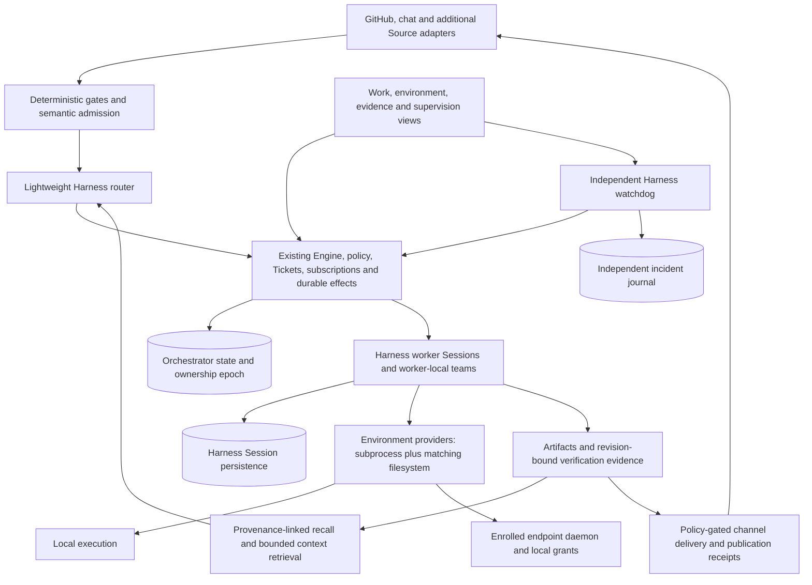

# Article implementation tracker

The active product objective also includes the full [Agentic OS workspace](010-agentic-os.md). Its implementation ledger
preserves these article requirements and adds missions, shared memory, artifacts, personas, schedules, usage and voice.

Target: implement the full article architecture in this fork, retaining DeepSeek Harness. Upstream baseline: `8c32a9dc5d72c033816c6a8110b37f40cf94fba4`. Baseline verification: `pnpm check`, 59 test files / 1,197 tests, typecheck and build passed on Node 25.9.0.

Sources: [DeepSeek's article](https://x.com/deepseekharness/status/2116857257245987236),
[reproduction of the article text](https://threadnavigator.com/thread/2116857257245987236/), and the upstream code at the baseline above.
The article includes both implemented ideas and research directions. Decisions below are this fork's implementation design,
not a claim that the prototype already ships every feature or that the article specifies a production protocol.

| Capability | Existing evidence | Remaining implementation |
| --- | --- | --- |
| Two-level coordination | `src/core/engine.ts`, `src/app/sessions.ts`, `src/executor/dsh.ts` | Separate router execution authority from routing; retain worker-local subagents |
| Event admission and routing | `src/policy.ts`, `src/core/intake.ts`, `src/core/evals.ts`, `src/sources/*` | Extend source scope only where required; retain subscription ownership and handback invariants |
| Context and recall | Immutable scoped records, provenance/FTS search, host-enforced cumulative retrieval allowances, bounded chain context/transitive freshness and complete review dependency closure | Measured retrieval and long-horizon validation, external-source freshness/imports, model-token-aware context selection and retention/scaling |
| Speculative work | Inferred mandates, observe/auto and rules; durable owner/provider/environment/workspace allocations, measured model usage, preemption, expiry, quiescence/recovery holds and separate promotion/publication approval | Long-horizon quality/waste measurements, multi-workspace/retention/scaling and stronger confinement |
| Full duplex | Harness job/subagent services, `src/executor/background.ts`, `src/app/delivery.ts`, remote receipts, durable assignment/tool ownership, receipt-only restart recovery and operator cancellation | Broader long-running job, process-failure and cross-host acceptance |
| Compute/state separation | SQLite Store; Harness Session checkpoints, held import, checkpoint-bound claimant replacement, revision-bound receipt audits and authenticated held receipt application including original administration; ownership authority, endpoint handoff fencing, shared Runtime/pool/provider lifecycle and independently fenced artifact/mission delivery with directed inbound replies | Private credential/runtime configuration validation, authoritative input/state recovery, remapping, broader inbound discovery/admission and repository integration, clean-host activation and failover qualification |
| Remote environments | Paired local/remote providers, authenticated leased grants, durable revocation, mission/Session binding, endpoint-owned versioned credentials, remote profile and artifact/restart qualification, operator enrollment/reconciliation, generated profiles, managed world pool and exact per-action selection | Managed endpoint/machine launch, remote repository workflows, quotas and cross-host acceptance |
| Watchdog | Existing health and bounded transient executor retry; now `src/supervision/*` | Live-provider and process-level acceptance, incident UI/alerts, retention, richer progress evidence and separately authorized recovery policies |
| Delivery | Reports and PR binding/closure; content-addressed artifacts, stale mission-review invalidation, reviewed artifacts and plan-authorized mission replies to GitHub issue/review and Feishu/Lark destinations with independent receipts; exact participant/task inbound listeners | Host-collected check evidence, Git/environment revision binding, broader inbound discovery/admission, repository integration and broader speculative quality evaluation |
| Operator control | Existing web panel, settings, pause/retry/stop, scoped usage/limits/prices and reconciliation, local/remote environment status and revocation, endpoint enrollment/reconciliation and private profile generation | Supervision, broader workload budgets and evidence surfaces |

No new runtime, orchestration database, or workflow framework is assumed. Work is implemented in integrated slices and not declared complete until acceptance evidence exists. Local deterministic tests do not establish live-provider or cross-platform acceptance.

## Implemented increment: speculative preparation and review

[045 Speculative preparation](045-speculative-preparation.md) adds assignment-bound durable owner/provider/environment
and workspace reservations, spare-capacity admission, explicit-work preemption, expiry, model usage integration,
quiescence/recovery holds and operator promotion. Exact-message approval is separate from promotion; artifact publication
also requires current promotion. API and bilingual review controls expose the lifecycle and reconciliation path.
The executor remains DeepSeek Harness. Qualification results are recorded below when each check completes.
This does not close long-horizon evaluation, stronger confinement, managed machine launch, host-collected verification,
recovery activation/failover, supervision, voice, packaging, onboarding or any remaining full-scope requirement below.

## Implemented increment: scheduled reflection and reviewed proposals

[044 Scheduled reflection](044-scheduled-reflection.md) adds bounded automatic selection of recent mission/activity/library
context, immutable pre-dispatch snapshots, assignment-bound reads, durable memory/plan/new-mission candidates and operator
review. Promotion rechecks cited evidence, preserves provenance and uses existing Workspace and Library transactions;
approval never dispatches the candidate work. The Reflections UI creates schedules and displays captured context,
omission bounds, review notes and promoted results.
Code `b53a3fd2d268a23175f85bb024660f4ae5567ec1` passed 1,718 local tests, typechecking and all builds, and 1,720 Linux
tests in [run 42591703174](https://github.com/jonsutton86/dsh-superagent-prototype/actions/runs/42591703174).
Both owned installed-Harness / DeepSeek Flash scenarios passed in 289.10 seconds, including the managed reflection
candidate, explicit approval and unchanged evidence/receipts/dispatch after restart. The original app remained running.
Reflection quality and long-horizon evaluation, external freshness/imports, retention/scaling, multi-workspace ownership,
speculative budgets/promotion, managed machine launch, host-collected checks, recovery activation/failover, supervision,
voice, packaging, onboarding and the remaining full article/product requirements stay open.

## Implemented increment: bounded Chain of Recall

[043 Chain of Recall](043-chain-recall.md) adds persisted per-execution/router-day retrieval allowances, atomic reservations,
bounded source/revision traversal, exact returned UTF-8 byte ceilings, scope checks at each node and operator limits/history.
Library freshness now follows source chains with explicit unknown results at inspection limits. Review fingerprints use the
complete accessible dependency closure so distant changes invalidate acceptance even when the display traversal is bounded.
Model token budgets remain in the inference ledger; retrieval bytes are not presented as exact model token counts.
Automatic reflection,
retrieval quality/long-horizon evaluation, external-source imports/freshness, speculative admission, retention, multi-workspace,
recovery activation/failover, voice and the remaining full architecture/product requirements stay open.

Code `1aaa87cc87f577345bfb2fd5bc51d7d6f62b48ca` passed 1,708 Linux tests, typechecking and all builds in
[run 42587579793](https://github.com/jonsutton86/dsh-superagent-prototype/actions/runs/42587579793).
The full local check passed 1,704 tests; the final focused run passed 56. Both owned installed-Harness / DeepSeek Flash
scenarios passed in 254.46 seconds, including an exact fact retrieved from a three-record source chain, persisted retrieval
charges across restart, usage refusal/retry, scheduled execution and held recovery. Stale or unknown source chains were
refused by the artifact publication gate in independent service tests. The original app remained running.

## Implemented increment: managed model usage and budgets

[042 Usage and budgets](042-usage-budgets.md) adds managed Harness call/token accounting, immutable price snapshots,
workspace/mission/schedule/persona limits, atomic admission reservations, uncertain-outcome reconciliation and operator UI.
Missing reports retain reservations across restart. Prices are explicit operator inputs and displayed costs are estimates;
provider invoices, exact prepared-generation metadata and non-token fees remain outside this increment. Speculative admission integration,
retention, multi-workspace ownership, reflection, recovery activation/failover, voice and all other full-scope requirements
remain open.

Accounting code `fd6b18542dea7df48a5ff1d67b1f50e9c7424118` passed 1,693 tests with native Linux confinement,
typechecking and all builds in [run 42582670631](https://github.com/jonsutton86/dsh-superagent-prototype/actions/runs/42582670631).
The full local check passed 1,690 tests; the final shutdown-guard focused run passed 27. Both owned installed-Harness /
DeepSeek Flash scenarios passed in 249.58 seconds, including scheduled usage/restart persistence, pre-inference budget
refusal and explicit retry after allowance changes. The original app remained running. UI follow-up
`f9eeb684c73da00cdbff86a170a57c1666affc0c` fixes switching between providers sharing a model name; eight focused
checks, typechecking and all builds passed with the live-qualified runtime unchanged.
The final UI code also passed all 1,693 Linux tests, typechecking and builds in
[run 42583242628](https://github.com/jonsutton86/dsh-superagent-prototype/actions/runs/42583242628).

## Implemented increment: persistent mission schedules

[041 Schedules](041-schedules.md) adds versioned complete-plan snapshots, timezone-aware calendar/interval/one-off
occurrences, missed-run policies, durable run and open-mission limits, transactional mission dispatch and operator controls.
Every occurrence uses Engine authorization with recorded standing authority, retains human dependencies and result review,
and resumes from its original reservation after restart. The Schedules page exposes timing, limits, pause/resume, history,
blocked dispatch retry and mission links. Reflection proposals, provider spend budgets, retention, multi-workspace ownership,
restored activation and the remaining full architecture/product requirements remain open.

Schedule code `a9371423fb5b12c63a430fb7e42aef7829e60128` passed 1,679 local tests, typechecking and all four builds.
The same code passed 1,681 tests with native Linux confinement, typechecking and all builds in
[run 42578515463](https://github.com/jonsutton86/dsh-superagent-prototype/actions/runs/42578515463).
Both owned installed-Harness / DeepSeek Flash scenarios passed in 235.73 seconds, including an actual scheduled worker,
independent file/artifact checks and restart deduplication before and after execution. The focused run passed 40 tests.
The existing app stayed running. Reflection proposals, provider usage/spend budgets, retention, multi-workspace ownership,
restored activation, voice and the rest of the full architecture/product ledger remain open.

## Implemented increment: pending input recovery across all current kinds

[040 Pending inputs](040-pending-input-recovery.md) extends accepted/read acknowledgement tracking to policy changes,
resume notices, notes and text inputs. Restart/retry preserves accepted unread inputs with assignment provenance; settled
reports recover eligible inputs while keeping automation held for a person. Delivery deduplication now returns consumed
evidence after flush so the executor can repair a lost Store read acknowledgement without another send. Held recovery
reconciles read markers for every current kind and keeps historical reopen records and ended outcomes unchanged.

Legacy inputs without delivery provenance, broader authoritative state, connector cursors, deployment binding, supported
activation and clean-host failover remain open with all other architecture/product requirements below.

Pending-input code `bc50b29cd3eccbf41c667e25d5cb62a3e75f9943` passed 1,665 local tests, typechecking and all four
builds; the focused run passed 224 tests. The same code passed 1,667 tests with native Linux confinement, typechecking
and all builds in [run 42575419242](https://github.com/jonsutton86/dsh-superagent-prototype/actions/runs/42575419242).
Both owned installed-Harness / DeepSeek Flash scenarios passed in 213.61 seconds. Managed recovery confirmed original
Store non-trigger read acknowledgements against authenticated worker history and preserved original-ID image retries.
The dedicated case retained its expected unrecorded-publication refusal. Channel traffic stayed on fixture servers and
the original app remained running. Full activation, failover and the remaining architecture/product scope remain open.

## Implemented increment: passive source contracts and settings recovery

[039 Source contracts](039-source-contract-recovery.md) separates loaded source schemas from polling and Runtime startup.
GitHub/Feishu register passively, while listeners still require the coordinator. Built-in adapters and recovery share schemas
and eligibility rules. Held preparation validates authenticated source/policy settings against the actual catalog, pins its
lifetime and registration revision, and checks for changes before final publication. Invalid settings or missing required
contracts fail held; explicitly disabled unknown settings remain opaque. Signed summaries, older image authentication and
original-ID retries are supported without treating catalog membership as provider authentication or activation authority.

Deployment binding, private legacy connector credentials, authoritative pending work and broader state relationships,
cursor reconciliation, runtime remapping, supported activation and clean-host failover remain open with every other full
architecture/product requirement below.

Source-contract code `24fe27f7e172d40e2f47e03c618ced6e2e0c9bca` passed 1,656 local tests, typechecking and all four
builds. The same code passed 1,658 tests with native Linux confinement, typechecking and all builds in
[run 42572760163](https://github.com/jonsutton86/dsh-superagent-prototype/actions/runs/42572760163).
Both owned installed-Harness / DeepSeek Flash scenarios passed in 202.70 seconds. Managed recovery loaded the bundle's
passive source catalog with the coordinator disabled, verified its signed source summary, and retrieved the same held image
on retry. The dedicated case retained its expected refusal for unrecorded publication probes. Focused source/recovery tests
passed 184 cases; bundle tests passed all three cases after their expected plugin list was updated. Provider-message traffic
stayed local and the original app remained running. Deployment binding, authoritative pending-work/cursor reconciliation,
supported activation, clean-host failover and the remaining architecture/product scope remain open.

## Implemented increment: consumed input acknowledgement recovery

[038 Consumed inputs](038-consumed-input-recovery.md) reconciles missing live input acknowledgements against authenticated
worker `user/message` history. It repairs read markers and undelivered queues only in the private held image, preserving
authority, assignments, original timestamps and ended outcomes. Queued/claimed/canceled inbox entries and inherited or
foreign messages cannot supply consumption evidence. Contradictions or cancellation roll back the entire batch; signed
counts record the result. Original-ID retries and older image authentication remain supported.

This does not complete authoritative-state recovery or activation. Source configuration, pending-work and broader state
relationships, runtime remapping, coordinated ownership handoff and clean-host failover remain open alongside every other
article/product requirement below.

Consumed-input recovery code `679a97ad8f290f060c07a332ba4de3a0bad690f7` passed 1,640 local tests, typechecking and all
four builds. The same code passed 1,642 tests with native Linux confinement, typechecking and all builds in
[run 42570416549](https://github.com/jonsutton86/dsh-superagent-prototype/actions/runs/42570416549).
Both owned installed-Harness / DeepSeek Flash scenarios passed in 197.68 seconds. Managed recovery verified the signed
consumption summary against actual worker inputs and returned the same held image on retry; the dedicated case retained
its expected refusal for unrecorded publication probes. The focused recovery/delivery run passed 133 tests. Provider-message
traffic stayed local and the original app remained running. Source configuration, broader authoritative-state reconciliation,
supported activation and the remaining full architecture/product requirements remain open.

## Implemented increment: recovery inference verification

`037-inference-configuration-recovery.md` adds required Harness inference checks to new held receipt preparation.
Authenticated settings and Session history select effective current routes through the public cold model-selection projection;
queued persona and current role defaults are included. A bounded history-free, tool-free probe runs through the actual
Harness provider path twice, with safe failure codes and signed count/configuration-digest evidence. Missing inference,
changed defaults, unusable streams and failed final probes preserve the hold. Original-ID retries remain historical and
older signed images remain readable without claiming new evidence.

This verifies the selected restore host, including its middleware. It does not establish an uncaptured source default or
private adapter endpoint/account identity. Source configuration, authoritative-state reconciliation, remapping, coordinated
activation and clean-host failover remain open, alongside every other article/product requirement below.

Inference-recovery code `891a31394a55825ab5d24c8eff2e8f858344f4ca` passed 1,616 local tests, typechecking and all four builds.
The same code passed 1,618 tests with native Linux confinement, typechecking and all builds in
[run 42567837206](https://github.com/jonsutton86/dsh-superagent-prototype/actions/runs/42567837206).
Both owned installed-Harness / DeepSeek Flash scenarios passed in 206.52 seconds. Managed recovery used the real
Session Controller projection and provider path, verified the signed inference summary, and retrieved its original held
image on retry. The dedicated case retained its expected refusal for unrecorded publication probes. Provider-message
traffic stayed local; the original app remained running. Source configuration, authoritative state and restored activation
remain open.

## Implemented increment: control credentials and publisher configuration

[036 Control configuration](036-control-configuration-recovery.md) verifies the reserved ownership claimant and the
coordinator's publication credential during audit and held preparation. Publisher checks use the exact inventory revision
and read-only provider preflight for every configured account/destination. Wrong roles, missing private files, changed
accounts and mismatched targets block recovery. Checks repeat before final publication; no lease or message is created.
Signed images contain only successful control-check counts. Historical retries do not reauthorize execution.

Inference/source configuration, authoritative input/state reconciliation, explicit remapping, coordinated restored activation
and clean-host failure qualification remain open alongside the full architecture and product ledger.

Code `56adf6dc2243fe40e41b8491a885623293a77762` passed 1,591 local tests, typechecking and all four builds. Focused
runs passed 92 recovery tests and 43 ownership/publication tests.
The same code passed 1,593 tests with native Linux confinement, typechecking and all builds in
[run 42564344905](https://github.com/jonsutton86/dsh-superagent-prototype/actions/runs/42564344905).
Both owned installed-Harness / DeepSeek Flash scenarios passed in 224.07 seconds. Managed recovery verified its actual
reserved claimant and coordinator publication credentials and the provider account/target, then authenticated the held
control summary and original-ID retry. The dedicated case retained its expected refusal for unrecorded publication probes.
Provider-message traffic stayed local; the original app remained running. Restored activation remains unqualified.

## Implemented increment: destination Session verification

[035 Destination Sessions](035-session-backend-recovery.md) verifies the actual imported Harness backend during held
preparation. It claims all selected Session writers, checks immutable metadata, inherited boundaries and exact logical
events, and rejects missing, shorter, divergent, newer or extra related history. It rechecks the catalog before publishing
and records only verified Session/event counts. No history is created, appended or truncated. Original-ID retries retain
their historical meaning; the per-Session writer API supplies no global catalog lock or future activation permit.

Broader private runtime/account configuration, authoritative input/state reconciliation, remapping, coordinated activation,
clean-host failure qualification and the full article/product ledger remain open.

Code `915cfc28f6b2ca10425a185376f85ae3d3c6b4e0` passed 1,562 local tests, typechecking and all four builds. The focused
recovery run passed 108 tests; the complete suite also covers authentication of older manifests without Session evidence.
Both owned installed-Harness / DeepSeek Flash scenarios passed in 192.86 seconds. Managed preparation used the separately
imported backend and authenticated its Session/event counts and original-ID retry; the dedicated case retained the expected
refusal for unrecorded publication probes. Linux passed 1,564 tests with native confinement, typechecking and all builds in
[run 42562981301](https://github.com/jonsutton86/dsh-superagent-prototype/actions/runs/42562981301).
Provider-message traffic stayed local; the original app remained running. Restored activation remains unqualified.

## Implemented increment: execution configuration during recovery

[034 Execution configuration](034-execution-configuration-recovery.md) checks original active-world grant credentials,
managed private pins, root identity and endpoint-private credential integrity during audit and preparation. It repeats private
file checks before final publication because those changes need not alter database revisions. Confirmed revoked worlds retain
their non-executable history without requiring retired credential files. Reports/manifests exclude private values and digests.
Inference, connector, publication and ownership-claimant configuration, external account permissions, authoritative state,
Session-backend validation, remapping and activation remain required alongside the full architecture ledger.

Qualified code `ea66ba2384e1a82da2f24401ab3f3e93f13368b0` passed 1,544 local tests, typechecking and all four builds.
Both owned installed-Harness / DeepSeek Flash scenarios passed in 193.93 seconds, including an active credential-bound
world alongside two revoked worlds in authenticated held preparation. Linux passed 1,546 tests with native confinement,
typechecking and all builds in [run 42561413655](https://github.com/jonsutton86/dsh-superagent-prototype/actions/runs/42561413655).
Provider-message traffic remained local; the original app stayed running. Restored activation remains unqualified.

## Implemented increment: original world-revocation recovery

[033 Revocation recovery](033-revocation-recovery.md) confirms the original grant-principal receipt when its acknowledgement
was lost or its process range quiesced later. It validates the exact disabled successor generation and original authority
binding, applies only the held world copy, and preserves the original request and source bytes. No revocation, cancellation,
lease or credential operation is sent during recovery. Missing/conflicting proof keeps preparation blocked. Private
configuration, authoritative input/state recovery, Session/backend validation, remapping and activation remain required.

Qualified code `8c1a66445b89b328ebcbdad61260b147505a10a2` passed 1,521 local tests, typechecking and all four builds.
Both owned installed-Harness / DeepSeek Flash scenarios passed in 195.07 seconds, including lost revocation acknowledgements
and confirmation that recovery did not resend them. The same code passed 1,523 tests with native confinement, typechecking
and all four builds in [Linux run 42559418182](https://github.com/jonsutton86/dsh-superagent-prototype/actions/runs/42559418182).
Provider-message traffic stayed on local contract servers; the original app stayed running. Restored activation remains open.

## Implemented increment: administrative recovery

[032 Administrative recovery](032-administrative-recovery.md) reconciles the coordinator's original endpoint commands
against historical independent receipts, without resending administration or issuing credentials. Pending grant records
remain unusable until private credential validation; replaced generations are superseded without becoming old-request results.
Active-world credential versions/status are included in the resource audit. Prepared images authenticate administrative
counts and preserve source state. Private credential/runtime configuration validation, authoritative input/state recovery,
actual Session validation, remapping and activation remain required, alongside the complete article and Agentic OS ledgers.
Original world-revocation acknowledgement recovery is implemented in the subsequent increment above.

Qualified code `3f2d4ba2ee7058fc8f037fb4c666e074b8ac3ca3` also corrects false abandoned-command refusals across sibling
providers and delayed catalog observations, with shared uncertainty fencing and preserved restart reconciliation. The final
local suite passed 1,508 tests; typechecking and all four builds passed. Both owned installed-Harness / DeepSeek Flash cases
passed in 201.96 seconds, including actual managed subagent work and repeated authenticated administrative receipt preparation.
Linux passed 1,510 tests with native confinement, typechecking and all builds in
[run 42558234881](https://github.com/jonsutton86/dsh-superagent-prototype/actions/runs/42558234881).
Provider-message traffic used local contract servers. The original app remained running; no restored activation was performed.

## Implemented increment: held receipt preparation

[031 Receipt preparation](031-recovery-receipt-preparation.md) applies revision-bound original command/file/publication
observations to a separate authenticated recovery image. It preserves source state, original ownership and request IDs,
settles original channel Outbox receipts, verifies every image member and supports retry after interrupted publication.
Both copies retain execution holds. Original administrative receipts are reconciled by the subsequent increment. Private credential/runtime configuration validation, authoritative input/state recovery,
Session-backend validation, remapping, activation, clean-host drills and the remaining article/product ledger stay open.
Local verification passed 1,495 tests, typechecking and four builds. Code `66b28a49f5a81dc08c6c5f19b0d31a5cfb66ba1e`
passed both owned installed-Harness/DeepSeek Flash cases in 201.43 seconds, including repeated authenticated preparation
and refusal of the checkpoint with unrecorded publication probes. The same code passed 1,497 native Linux tests,
typechecking and all builds in [run 42554537411](https://github.com/jonsutton86/dsh-superagent-prototype/actions/runs/42554537411).
Provider-message traffic used local contract servers; restored activation remains unqualified.

## Implemented increment: recovery receipt audit

[030 Receipt audit](030-recovery-receipt-audit.md) adds administrator-only revision-bound endpoint/publisher inventories,
complete enrolled-resource coverage, original command/file/publication intent comparison and durable held reports. It detects
unrecorded effects, missing receipts, changed identities/results and unsettled work; it observes completed original effects
without replay. Every staged world/Session member is verified, and changed pages or authority invalidate the audit.

Receipt application is now implemented by the held preparation increment. Administrative-command/configuration reconciliation, authoritative input/state recovery, actual
Session-backend validation, world remapping, activation and clean-host drills remain required. No audit removes the hold.
The full article and product architecture remain in progress. Code `44b3fa54685ee4cf471c5b26db1ccc4c918337ba` passed
1,482 local tests, typechecking and all four builds. Both owned installed-Harness/DeepSeek Flash scenarios passed in
215.31 seconds, including repeated audits, every original receipt, full resource coverage and exact identification of four
unrecorded publication probes. The held state stayed non-executable. It also passed 1,484 native Linux tests, typechecking
and all builds in [run 42552272631](https://github.com/jonsutton86/dsh-superagent-prototype/actions/runs/42552272631).
Provider-message traffic stayed on local contract servers; live-account acceptance and restored activation remain open.

## Implemented increment: recovery ownership reservations

[029 Recovery reservations](029-recovery-reservations.md) authenticates the selected held checkpoint, compares its logical
database with staged state, and reserves a replacement claimant generation through independent administration. The source
claimant becomes invalid. Durable original requests survive lost responses, authority restart and credential-write failure;
superseded retries never adopt the newest credential. Resource drain barriers and the staged execution hold remain intact.

Receipt inventory/reconciliation, post-checkpoint divergence, Session/world validation for activation, explicit path and
credential remapping, clean-host activation/failover and every remaining article/product capability still require work.
This increment does not make a staged restore executable. Code revision `6d2ef214431d030c82ba2174f5e52ecc10b5acef`
passed local `pnpm check` on 2026-11-08: 1,468 tests, typechecking and all four builds. Both owned installed-Harness/DeepSeek
Flash scenarios passed on the final build in 199.31 seconds, including capture, repeated Session import, original reservation
retries, retained holds and source claimant rejection. It also passed 1,470 tests, typechecking and all builds with native
Linux confinement in [run 42549125311](https://github.com/jonsutton86/dsh-superagent-prototype/actions/runs/42549125311).
Provider message traffic stayed on local contract servers; this does not qualify live-account permissions or clean-host failover.

## Implemented increment: inbound task conversations

[028 Inbound conversations](028-inbound-conversations.md) adds explicit participant/task listeners to the independently owned
publisher. GitHub issue/review and Feishu/Lark root replies can steer the original task; cursor and receipt state survive
restarts, native IDs prevent replay, and the Engine enforces the recipient through fanout, routing, evaluation and worker
reads. The mission panel exposes consent, lost-save recovery, polling/rescans, pause and unsupported-message records.

This covers incoming replies to operator-selected existing tasks. Repository-wide discovery, source-originated admission,
rich content, Git/PR mutations, retention and restore activation/failover still require implementation. The full article and
Agentic OS ledger remain active. Local `pnpm check` on 2026-11-08 passed 1,457 tests, typechecking and all four builds.
Both owned installed-Harness/DeepSeek Flash scenarios passed on the final build (191.45 seconds), including an external
reply resuming the same task, an actual worker acknowledgement, unchanged artifact content and retained receipts/deduplication
after coordinator restart. Provider traffic stayed on local contract servers. Code revision
`a558cdd5f6bf2de59512afb60373cff2465fb74b` passed 1,459 tests with native Linux confinement, typechecking and all four builds
in [run 42546908912](https://github.com/jonsutton86/dsh-superagent-prototype/actions/runs/42546908912).

## Implemented increment: mission reply delivery

[027 Mission delivery](027-mission-delivery.md) attaches an operator-authorized publication Channel to new workspace
tickets for an exact plan/destination grant. Existing worker acknowledgement and router reply tools use the Outbox and
independent publisher. Revocation stops new sends while preserving unknown original outcomes; withdrawal keeps receipt
history and unresolved messages retain conversation ordering. The mission UI supports standing consent and recovery after
lost configuration replies. Providers now include pinned GitHub review threads and self-built Feishu/Lark bot replies.

This increment established outbound mission delivery. Inbound task conversations are added above. Owned profiles still
disable old CLI-backed inbound sources and repository workflows. Broader source admission, Git/PR mutations, host
verification, restore activation/failover and the full product ledger remain open.

Local qualification on 2026-11-08: `pnpm check` passed 1,437 tests, typechecking and all four builds. Both owned
installed-Harness/DeepSeek Flash scenarios passed, including actual acknowledgements and retained delivery receipts.
Exact code revision `3bf6a280f992c2e8621f6ec388879785f7827598` also passed 1,439 tests with native Linux confinement,
typechecking and all four builds in
[run 42543761724](https://github.com/jonsutton86/dsh-superagent-prototype/actions/runs/42543761724).

## Implemented increment: artifact publication

[026 Artifact publication](026-artifact-publication.md) adds a dedicated Harness publication service with private account
credentials, pinned destinations, final ownership checks and a durable journal. The Runtime and library UI bind review to
exact artifact content and destination hashes. Lost acknowledgements preserve the original request ID; an unknown provider
outcome blocks owner handoff until observation or independent administrator reconciliation. Checkpoints include control
credential file dependencies without copying their contents. The restore hold remains in place.

This path covers operator-approved text artifacts as GitHub issue/PR top-level comments. Source Outbox integration,
Feishu, review-thread replies, git/PR mutations, automatic mandate-bound delivery, host-collected verification evidence
and clean-host activation/failover remain open. The full article and product scope is unchanged.

Local qualification on 2026-11-08: 1,418 tests, typechecking and all four builds passed. Both owned installed-Harness
DeepSeek Flash scenarios also passed, including independent publication plugin loading and restart. Exact code revision
`fd058c95ad6046751fd0429a6046c1bb1e151316` passed 1,420 native Linux tests, typechecking and all four builds in
[run 42540908750](https://github.com/jonsutton86/dsh-superagent-prototype/actions/runs/42540908750).

## Implemented increment: Runtime ownership

[025 Runtime ownership](025-runtime-ownership.md) binds coordinator startup, dedicated providers, managed worlds,
endpoint administration and Session/tool admission to the same independent lease. Loss stops dispatch and background work;
separate-state competing coordinators cannot execute concurrently. Existing profiles remain compatible. Owned general
missions require matching remote endpoints; external account publication requires its own fenced integration. Staged
restore remains held before acquisition. Publication, clean-host activation/failover and the full product ledger stay open.

Verification: code `ba17edd5fe09d9276b8d27168188f7f6d9b83abe` passed 1,406 local tests, typechecking and all builds,
all four installed-Harness model scenarios, and 1,408 native Linux tests in
[run 42537715231](https://github.com/jonsutton86/dsh-superagent-prototype/actions/runs/42537715231).

## Implemented increment: ownership authority and endpoint fencing

[024 Ownership and resource fencing](024-ownership-fencing.md) adds an independent Harness authority, process-instance
leases, all-resource preparation and endpoint cancellation/reconciliation before handoff. Paired worlds retain their grant
identity and original effect generations. Code `7e2a33cc4ff662188eee52417056900b4c21e0c4` passed 1,400 local tests,
both installed-Harness cases, and 1,402 tests with native confinement enabled in
[Linux run 42535557440](https://github.com/jonsutton86/dsh-superagent-prototype/actions/runs/42535557440).
The live authority process restart/handoff was qualified separately from model missions in that increment. Runtime/pool
integration follows above; publication, restored activation and clean-host failover remain open. The staged hold is retained.

## Implemented increment: managed execution worlds

[022 Managed worlds](022-managed-worlds.md) adds independently activated remote worlds under one personal/local coordinator,
exact per-action environment selection, paired Harness preset scopes and world-specific lifecycle and execution receipts.
The coordinator preserves its own providers; an unavailable world cannot fall back to another world or local execution.
Revocation closes only the selected world's admission and keeps original-ID recovery and receipt inspection across restart.
The increment retains DeepSeek Harness and the existing Engine, Store and remote endpoint. Managed machine launch, remote
repository workflows, distributed state ownership/failover, quotas and full product acceptance remain open.

Code commit `cecfde32924209bca220bcf01fd9ac3b28aedabd` passed 1,376 local tests, typechecking and all four builds on
2026-11-08. Both opt-in Harness/DeepSeek Flash cases passed separately: dedicated profile plus managed worlds with
concurrent artifact publication, child-owned effects, independent revocation, revoked receipt recovery and resumed work
after coordinator restart. The same commit passed
[Linux run 42528377954](https://github.com/jonsutton86/dsh-superagent-prototype/actions/runs/42528377954) with 1,378 tests,
typechecking, all four builds and all three native confinement cases. Cross-host deployment and distributed ownership remain open.

## Implemented increment: versioned execution personas

[021 Personas](021-personas.md) adds operator-managed immutable instructions, model preferences, optional tool capabilities
and embedded skills. Mission actions and reviewed plan proposals select exact versions; execution snapshots and resumed
worker descendants retain those versions after later edits or archival. Persona updates do not grant additional environment
authority. The panel supports creation, editing, exact historical reads, restoration as a new version, archival and per-action
selection. The subsequent managed-world increment supplies the registry and paired provider scopes for exact per-action
environment selection; persona policy still does not replace execution-world authority.

Qualification on 2026-11-08: 1,366 local tests, 1,368 Linux tests, typechecking and all four builds passed. Exact code commit
`2610c3e69b3f0b0776c484ec2a133ba4cc2d7674` passed
[Linux run 42524823550](https://github.com/jonsutton86/dsh-superagent-prototype/actions/runs/42524823550), including all three
native confinement cases. The configured DeepSeek Flash/Harness test separately proved persona skill loading, owned remote
execution, artifact publication and unchanged persona/world snapshots after edit/archive and coordinator restart.

## Implemented increment: independent supervision

The code now includes the authenticated observation/recovery API, independently persisted incidents and delivery reservations,
separate Harness watchdog plugin and profile, restricted assessment tools, local operator status and regression tests.
[009 Independent supervision](009-supervision.md) describes deployment, authority, limits and verification boundaries.
This increment is code and tested integration, not an enabled live deployment or completion of the entire article.

Verification on 2026-11-06: `pnpm check` passes typechecking, 62 test files / 1,221 tests (24 added tests), and all bundle
builds, including the separately exported `dsh-superagent/watchdog`. The built entry's import and default/custom model
configuration were also checked directly in Node. A DeepSeek Harness CLI/provider deployment was not available in this
checkout environment, so no live-provider or unattended production acceptance is claimed.

## Target architecture

The [remote transport increment](016-remote-execution.md) adds a separately exported authenticated endpoint, durable command
and file-effect receipts, leased grants, output cursors and paired Harness filesystem/process providers. File RPC and commands
use the same Linux bubblewrap boundary in production. Real local Harness providers exercise the HTTP and recovery tests;
the full suite also passed with native Linux confinement and detached-child cancellation enabled in CI. Remote mission
selection, operator endpoint enrollment/reconciliation and coordinator ownership remain open.
This is an execution foundation, not completion of the distributed architecture.

The remote provider now also persists its exact authority binding and local revocation intent. A changed credential cannot
silently transfer new authority across a restart. Self-revocation needs only the current grant, replays the same request after
disconnects, and reports endpoint acknowledgement separately from process/file quiescence. The
[remote mission increment](017-remote-missions.md) now composes a dedicated whole Harness profile and binds missions, worker
Sessions and children to that exact authority. Remote directory preparation, bounded endpoint searches, typed router tools
and operator revocation are integrated. Actual Harness with the configured DeepSeek Flash provider has created/published a
remote artifact and preserved authority and request idempotency through restart. This local composition test uses a test-only
endpoint on macOS; native confinement and cross-host deployment remain distinct qualification boundaries.

Remote mission verification on 2026-11-08: local `pnpm check` passed 1,326 tests, typechecking and all builds; the real Harness
Flash artifact/restart qualification passed separately. Commit `d8223312706205e2f9cfa352b975cc603b1ab75a` passed
[Linux run 42515787855](https://github.com/jonsutton86/dsh-superagent-prototype/actions/runs/42515787855) with 1,327 tests,
including native mission dispatch and filesystem/process confinement. The full product goal remains open; the next remote
work includes operator enrollment/reconciliation before per-action multi-environment dispatch.

The [execution ownership increment](018-execution-ownership.md) records trusted mission/assignment/Session/tool ownership
before command or file-effect dispatch, compares endpoint fingerprints, and recovers by observing original receipt IDs.
Unresolved and recovered running effects block new work without blindly replaying it. The Environments and task views
expose paginated metadata, read-only observation and same-ID command cancellation while keeping outcome and quiescence
separate. On 2026-11-08, local `pnpm check` passed 1,336 tests, typechecking and all builds. The configured-model qualification
verified ownership through an actual Harness restart on the final build. Code commit
`5ca3cbce579c0a96208ec1276eedefefb2cc11e6` passed
[Linux run 42517702121](https://github.com/jonsutton86/dsh-superagent-prototype/actions/runs/42517702121) with 1,337 tests,
typechecking and all builds, including native confinement, child/tool ownership, receipt APIs and command cancellation.
The full architecture remains in progress; operator enrollment/reconciliation is integrated in the subsequent administration increment.

The [endpoint credential increment](019-endpoint-credentials.md) adds administrator-only private-file import, immutable
credential versions, explicit grant bindings, revocation/rotation fencing and command cancellation. Read-only credential
mounts and a confined POSIX launcher keep injected values out of provider arguments and receipt metadata. The coordinator
displays binding metadata; credentials remain an explicit capability available to code under that grant. The configured-model
Harness qualification has used a synthetic bound credential, produced an artifact and preserved the world through restart.
Endpoint enrollment UI is integrated in the subsequent administration increment. Per-action environment/persona selection and the remaining article/product requirements stay open.

Credential verification on 2026-11-08: local `pnpm check` passed 1,345 tests, typechecking and all builds, followed by a passing
configured-model Harness credential/artifact/restart qualification on the final build. Code commit
`18b2dc8c1f0409c5c6266daf35638590f1ea1a99` passed
[Linux run 42519570124](https://github.com/jonsutton86/dsh-superagent-prototype/actions/runs/42519570124) with 1,347 tests,
typechecking and all four builds. The native credential case exercised read-only mounts and cancellation on revocation.

The [endpoint administration increment](020-endpoint-administration.md) adds pinned private-file administrator registration,
metadata catalogs, durable operator request IDs, explicit retry/reconciliation, grant and credential forms, generation-safe
grant credential publication and complete dedicated Harness profile generation. Lost-response replays cannot adopt later
authority. The opt-in model qualification consumes the generated overlay without modifying it. Managed launch and per-action
world/persona selection follow; the full article/product scope remains open. Local `pnpm check` passed 1,356 tests across
79 files, typechecking and all four builds on 2026-11-08; the generated-profile configured-model qualification passed
separately with credential use, artifact publication, execution attribution and coordinator restart. Code commit
`0c07ac80126d4aa9c0fbefd5047fcc96742eda37` passed
[Linux run 42522276793](https://github.com/jonsutton86/dsh-superagent-prototype/actions/runs/42522276793) with 1,358 tests,
typechecking and all builds, including all three native confinement cases and the large-catalog regression.

The [environment enrollment increment](015-execution-environments.md) implements local root proof, immutable task grant
bindings, revocation, reauthorization, replacement and operator controls. Its generation is local authorization state;
remote endpoint grants and their leases are integrated in the subsequent remote increments; coordinator ownership is still separate.

The [mission planning increment](014-mission-plans.md) adds editable immutable versions, scoped worker proposals, explicit
operator approval, history restoration and transitive result invalidation. Planning uses existing Harness workers and
Engine dispatch; candidate plans never authorize their own execution.

The [Inbox increment](013-inbox.md) adds durable read state, Harness conversation projections, atomic task creation and
idempotent steering through existing mission authorization. Result follow-ups preserve the original mandate, explicit
human stops remain holds, and pending follow-ups prevent acceptance of an outdated result.

The [local execution increment](012-local-execution.md) removes mandatory GitHub setup for general missions, retaining
the same Engine/Harness dispatch and durable results. A real isolated Harness process has passed startup and persisted
mission/artifact state across a restart. With the operator's configured DeepSeek provider, one live Flash mission created
a local JSON file, published it, entered review and completed after independent content/hash checking. Remote enrollment,
OS isolation, broader provider qualification and the remaining article work below are still required.

The [durable library increment](011-library.md) implements worker publication, scoped memory/artifact search, immutable
provenance and the operator library. These are candidate results: host-verified task success and external delivery remain
separate requirements. The library's limits and local process trust boundary are explicit in that document.

The Agentic OS mission workspace increment is implemented and verified in `010-agentic-os.md`. It adds a local operator
source and persistent goals over this same Engine/Harness path; it does not replace the remaining article work below.

DeepSeek Harness remains responsible for inference, tools, Sessions, compaction, async jobs, subagents, provider selection
and cancellation. The existing Engine remains responsible for authorization, work ownership, routing, follow-up handling,
subscriptions and state transitions. SQLite remains the initial durable store. A separate database framework or workflow
engine is not a prerequisite. State ownership stays single-writer until a measured requirement justifies a different backend.

The final design separates three concerns: agent compute, durable task/Session state, and the filesystem/process environment
where tools act. The current same-host implementation is one deployment of those responsibilities. Remote execution must
replace **both** Harness's subprocess and filesystem world consistently; changing the shell transport alone is insufficient.
Profiles or host scopes bound to an environment provide an initial isolation boundary while preserving the Harness loop.

## Implementation sequence and acceptance

### 1. Supervision and operational visibility — implemented foundation

Current code provides independent observations, semantic assessments and one fenced progress request per assignment.
Complete deployment acceptance with a configured provider, main-process kill/restart, watchdog-process restart, disconnected
transport and a deliberately long but productive job. Add incident UI, explicit operator acknowledgement, retention and
alert routing before calling the operational experience complete. Process restarts or task retries require their own narrow,
audited recovery policies; they must not be inferred from arbitrary worker text.

### 2. Compute/state/environment contracts and remote execution — whole-profile mission integration implemented

Introduce an environment registry in the existing state store. Each environment has a stable ID, endpoint identity,
capabilities, availability, grant revision and lease epoch. Bind a ticket's execution to that environment and grant revision.
Keep the existing local path as the first provider. Add a remote Harness provider paired with its filesystem implementation;
do not replace `DshExecutor` with another inference framework.

The endpoint protocol needs authenticated enrollment and revocation, scoped workspaces, allowed operations, environment-local
credentials, process IDs, durable command IDs, lease epochs, output cursors and completion receipts. Distinguish `accepted`,
`started`, `settled` and `unknown` outcomes. Reconnect reconciles receipts and streams missing output; it must never rerun a
command merely because its acknowledgement was lost. A queued operation revalidates its grant after offline reconnection.
Keep the agent's state and credentials outside the endpoint unless an operation explicitly requires them.

Implemented transport details and exercised versus outstanding acceptance are recorded in `016-remote-execution.md`.
Whole-profile remote dispatch is integrated into the existing registry and `DshExecutor`, with immutable task and Session
world bindings. `017-remote-missions.md` records the profile, real-model qualification and explicit scope. Next, add per-action
environment selection and endpoint enrollment/reconciliation. Endpoint credential bindings are integrated in
`019-endpoint-credentials.md`. Durable command-to-assignment
receipts and operator observation/cancellation are integrated in `018-execution-ownership.md`. Run
`pnpm test:remote-linux` on the intended Linux runtime before deployment claims.

Acceptance: remote shell and file operations see the same workspace; disconnect during execution does not duplicate an
effect; revoke a grant while offline; reconnect with an obsolete lease; cancel descendants; read output without gaps or
duplicates; enforce workspace/symlink boundaries; show unknown outcomes for operator reconciliation.

### 3. Durable restore and state ownership — staged import and endpoint ownership implemented

Use Harness's Session-persistence abstraction alongside the existing orchestration store. Define a consistent checkpoint
manifest covering task state, Session offsets, environment leases and artifact references. A restored coordinator acquires
exclusive ownership before resuming effects. A stale coordinator cannot issue environment or publication commands under its
old epoch. Avoid shared-network SQLite as a substitute for an ownership protocol.

Implemented: `023-checkpoint-recovery.md` defines encrypted offline capture of the Store, logical Harness Sessions and world
journals, full verification, execution-fenced staging and retryable Session import. It does not grant execution ownership.
`024-ownership-fencing.md` adds an independent ownership authority, conservative process leases, all-resource handoff and
real endpoint enforcement, preserving world identities and original effect generations across handoff. The authority is a
single writer, not a replicated consensus service. `025-runtime-ownership.md` connects the Runtime and managed/dedicated
provider lifecycle to that authority. `026-artifact-publication.md` adds independently fenced artifact delivery;
`027-mission-delivery.md` routes plan-authorized mission replies through the Outbox and publisher. `028-inbound-conversations.md`
adds directed replies from authorized participants through that service. Next: complete broader source discovery/admission
and repository integration. Receipt audits and held preparation are implemented; complete private credential/runtime configuration, Session, world and authoritative-state reconciliation before activating a restored coordinator. The maintenance
hold stays in place. Keep clean-host recovery and failover open until that complete path is qualified.

Acceptance: crash after every enqueue/dispatch/receipt boundary; recover a consistent task/Session pair; reject two active
writers; resume pending input once; reconcile already-started work; restore from a documented backup on a clean host.

### 4. Chain of Recall and long-term knowledge

Extend the existing resource interface with immutable context capsules and typed provenance edges: `derived_from`,
`supersedes`, `supports`, `contradicts` and `references`. A capsule includes owner/scope, source IDs and revisions, timestamps,
content hash, retention policy and trust classification. Inline small context; spill large context behind stable resource
references. Retrieval returns bounded text with source links, freshness and access decisions. Start with SQLite metadata
and full-text retrieval; embeddings are an optional measured improvement rather than an architectural dependency.

Workers can submit candidate knowledge with evidence. A model summary never creates authority, overwrites a source, or
widens who may retrieve it. Conflicts and stale knowledge remain visible. Recall budgets bound graph depth, pages, time
and returned context. Cross-agent sharing uses the same scope and provenance checks.

Acceptance: recall across Session compaction and restart; recover a fact through its reference chain; reject inaccessible
nodes; invalidate stale evidence; preserve contradictory sources; resist instructions embedded in retrieved content; compare
retrieval quality on real work, not only the article's synthetic scheduling experiment.

### 5. Speculative work with measurable budgets

Implemented in 045: an explicit speculative lifecycle on top of inferred mandates: proposal, admitted background preparation, evidence-ready,
promoted, expired or cancelled. Allocate per-owner/provider/environment concurrency, time and usage budgets durably before
starting work. Speculation consumes spare capacity and yields to explicit work. Promotion rechecks current authorization;
external publication uses a separate gate. Cancellation releases reservations only after execution quiesces or its outcome
has been reconciled.

Acceptance: competing admissions cannot overspend the same reservation; explicit work can preempt speculation; expired
work cannot publish; a restart preserves spent usage and active reservations; promotion keeps provenance and does not
repeat completed work. Provider usage reporting and enforceable limits remain distinguished from approximate cost estimates. Long-horizon
quality/waste measurement, scaling, multi-workspace ownership and stronger confinement still require acceptance evidence.

### 6. Verified artifacts and delivery

Persist artifacts and verification results bound to exact source/workspace revisions: commit/tree IDs, content hashes,
command or check identities, exit outcomes and timestamps. Verification evidence is collected by host integrations;
model assertions alone do not satisfy it. Publication binds the approved artifact revision to its destination and receipt.
After an ambiguous external response, query the destination before retrying publication.

Acceptance: a subsequent edit invalidates prior checks; stale branch evidence cannot approve a new PR head; duplicate
delivery requests do not publish twice; failed/unknown effects remain recoverable; each user-visible result links its actual
artifact and relevant evidence. Keep existing GitHub follow-up/PR ownership and handback invariants.

### 7. Router authority and operator experience

Replace the router's remaining broad shell reads with typed, bounded Source/resource operations before removing those
tools. Keep semantic batching, subscriptions, selective pass-through, many-to-many ownership and worker-local teams. Add
task-centered views for timeline, artifacts, evidence, environments, budgets and incidents while retaining the working panel.
User steering remains asynchronous and reaches workers at safe inference boundaries. Channel adapters tailor the length and
form of replies while decisions and authority remain centralized in the Engine.

Acceptance: the router cannot execute an assigned task or modify files; all prior admission/routing tests pass; users can
inspect, steer, pause, cancel and review outcomes without navigating internal Session IDs; permissions and unknown remote
outcomes are visible at the point of action.

### 8. Whole-system qualification

Run repeatable workload evaluations covering real coding tasks, event bursts, concurrent subscriptions, long-running tools,
context growth, provider outages, prompt injection, revoked access, corrupted/partial receipts and process/host failure.
Record task quality, latency, user interruptions, wasted speculative work, inference usage, recovery time and duplicate
external effects. Document supported OS/environment combinations, backup/restore, upgrades and credential rotation.
Declare complete only when each capability above has executable evidence and a supported operator path. Cross-organization
agent communication remains explicitly scoped work with its own identity/delegation contract; it is not silently assumed
from the article's open research discussion.
