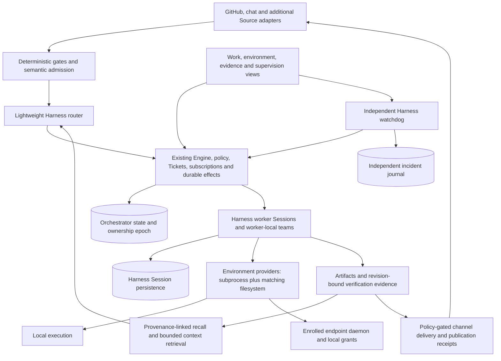

# Article implementation tracker

The active product objective also includes the full [Agentic OS workspace](010-agentic-os.md). Its implementation ledger
preserves these article requirements and adds missions, shared memory, artifacts, personas, schedules, usage and voice.

Target: implement the full article architecture in this fork, retaining DeepSeek Harness. Upstream baseline: `8c32a9dc5d72c033816c6a8110b37f40cf94fba4`. Baseline verification: `pnpm check`, 59 test files / 1,197 tests, typecheck and build passed on Node 25.9.0.

Sources: [DeepSeek's article](https://x.com/deepseekharness/status/2116857257245987236),
[reproduction of the article text](https://threadnavigator.com/thread/2116857257245987236/), and the upstream code at the baseline above.
The article includes both implemented ideas and research directions. Decisions below are this fork's implementation design,
not a claim that the prototype already ships every feature or that the article specifies a production protocol.

| Capability | Existing evidence | Remaining implementation |
| --- | --- | --- |
| Two-level coordination | `src/core/engine.ts`, `src/app/sessions.ts`, `src/executor/dsh.ts` | Separate router execution authority from routing; retain worker-local subagents |
| Event admission and routing | `src/policy.ts`, `src/core/intake.ts`, `src/core/evals.ts`, `src/sources/*` | Extend source scope only where required; retain subscription ownership and handback invariants |
| Context and recall | Existing resources plus `src/workspace/library.ts`: immutable scoped records, provenance and FTS recall | Enforced total recall budgets, transitive freshness, measured retrieval and long-horizon validation |
| Speculative work | Inferred mandates, observe/auto, configurable rules | Durable budgets, expiry and promotion/publication gates |
| Full duplex | Harness job/subagent services, `src/executor/background.ts`, `src/app/delivery.ts`, remote process receipts and reconnect | Durable command-to-assignment receipts and broader restart/unknown-effect integration |
| Compute/state separation | SQLite Store; Harness session persistence service abstraction | Deployable persistent-state ownership and restore/failover integration |
| Remote environments | Paired local/remote providers, authenticated leased grants, durable revocation, mission/Session binding, remote profile and artifact/restart qualification | Per-action environment selection, endpoint credentials, operator enrollment/reconciliation, quotas and cross-host acceptance |
| Watchdog | Existing health and bounded transient executor retry; now `src/supervision/*` | Live-provider and process-level acceptance, incident UI/alerts, retention, richer progress evidence and separately authorized recovery policies |
| Delivery | Reports and PR binding/closure; content-addressed artifacts and stale mission-review invalidation | Host-collected check evidence, Git/environment revision binding and external publication receipts |
| Operator control | Existing web panel, settings, pause/retry/stop and local/remote environment status and revocation | Endpoint enrollment/reconciliation, supervision, budgets and evidence surfaces |

No new runtime, orchestration database, or workflow framework is assumed. Work is implemented in integrated slices and not declared complete until acceptance evidence exists. Local deterministic tests do not establish live-provider or cross-platform acceptance.

## Implemented increment: independent supervision

The code now includes the authenticated observation/recovery API, independently persisted incidents and delivery reservations,
separate Harness watchdog plugin and profile, restricted assessment tools, local operator status and regression tests.
[009 Independent supervision](009-supervision.md) describes deployment, authority, limits and verification boundaries.
This increment is code and tested integration, not an enabled live deployment or completion of the entire article.

Verification on 2026-11-06: `pnpm check` passes typechecking, 62 test files / 1,221 tests (24 added tests), and all bundle
builds, including the separately exported `dsh-superagent/watchdog`. The built entry's import and default/custom model
configuration were also checked directly in Node. A DeepSeek Harness CLI/provider deployment was not available in this
checkout environment, so no live-provider or unattended production acceptance is claimed.

## Target architecture

The [remote transport increment](016-remote-execution.md) adds a separately exported authenticated endpoint, durable command
and file-effect receipts, leased grants, output cursors and paired Harness filesystem/process providers. File RPC and commands
use the same Linux bubblewrap boundary in production. Real local Harness providers exercise the HTTP and recovery tests;
the full suite also passed with native Linux confinement and detached-child cancellation enabled in CI. Remote mission
selection, operator endpoint enrollment/reconciliation, endpoint credential bindings and coordinator ownership remain open.
This is an execution foundation, not completion of the distributed architecture.

The remote provider now also persists its exact authority binding and local revocation intent. A changed credential cannot
silently transfer new authority across a restart. Self-revocation needs only the current grant, replays the same request after
disconnects, and reports endpoint acknowledgement separately from process/file quiescence. The
[remote mission increment](017-remote-missions.md) now composes a dedicated whole Harness profile and binds missions, worker
Sessions and children to that exact authority. Remote directory preparation, bounded endpoint searches, typed router tools
and operator revocation are integrated. Actual Harness with the configured DeepSeek Flash provider has created/published a
remote artifact and preserved authority and request idempotency through restart. This local composition test uses a test-only
endpoint on macOS; native confinement and cross-host deployment remain distinct qualification boundaries.

Remote mission verification on 2026-11-08: local `pnpm check` passed 1,326 tests, typechecking and all builds; the real Harness
Flash artifact/restart qualification passed separately. Commit `d8223312706205e2f9cfa352b975cc603b1ab75a` passed
[Linux run 42515787855](https://github.com/jonsutton86/dsh-superagent-prototype/actions/runs/42515787855) with 1,327 tests,
including native mission dispatch and filesystem/process confinement. The full product goal remains open; the next remote
work is durable command-to-assignment ownership, endpoint credential binding and operator enrollment/reconciliation before
per-action multi-environment dispatch.

The [environment enrollment increment](015-execution-environments.md) implements local root proof, immutable task grant
bindings, revocation, reauthorization, replacement and operator controls. Its generation is local authorization state;
remote endpoint grants and their leases are integrated in the subsequent remote increments; coordinator ownership is still separate.

The [mission planning increment](014-mission-plans.md) adds editable immutable versions, scoped worker proposals, explicit
operator approval, history restoration and transitive result invalidation. Planning uses existing Harness workers and
Engine dispatch; candidate plans never authorize their own execution.

The [Inbox increment](013-inbox.md) adds durable read state, Harness conversation projections, atomic task creation and
idempotent steering through existing mission authorization. Result follow-ups preserve the original mandate, explicit
human stops remain holds, and pending follow-ups prevent acceptance of an outdated result.

The [local execution increment](012-local-execution.md) removes mandatory GitHub setup for general missions, retaining
the same Engine/Harness dispatch and durable results. A real isolated Harness process has passed startup and persisted
mission/artifact state across a restart. With the operator's configured DeepSeek provider, one live Flash mission created
a local JSON file, published it, entered review and completed after independent content/hash checking. Remote enrollment,
OS isolation, broader provider qualification and the remaining article work below are still required.

The [durable library increment](011-library.md) implements worker publication, scoped memory/artifact search, immutable
provenance and the operator library. These are candidate results: host-verified task success and external delivery remain
separate requirements. The library's limits and local process trust boundary are explicit in that document.

The Agentic OS mission workspace increment is implemented and verified in `010-agentic-os.md`. It adds a local operator
source and persistent goals over this same Engine/Harness path; it does not replace the remaining article work below.

DeepSeek Harness remains responsible for inference, tools, Sessions, compaction, async jobs, subagents, provider selection
and cancellation. The existing Engine remains responsible for authorization, work ownership, routing, follow-up handling,
subscriptions and state transitions. SQLite remains the initial durable store. A separate database framework or workflow
engine is not a prerequisite. State ownership stays single-writer until a measured requirement justifies a different backend.

The final design separates three concerns: agent compute, durable task/Session state, and the filesystem/process environment
where tools act. The current same-host implementation is one deployment of those responsibilities. Remote execution must
replace **both** Harness's subprocess and filesystem world consistently; changing the shell transport alone is insufficient.
Profiles or host scopes bound to an environment provide an initial isolation boundary while preserving the Harness loop.

## Implementation sequence and acceptance

### 1. Supervision and operational visibility — implemented foundation

Current code provides independent observations, semantic assessments and one fenced progress request per assignment.
Complete deployment acceptance with a configured provider, main-process kill/restart, watchdog-process restart, disconnected
transport and a deliberately long but productive job. Add incident UI, explicit operator acknowledgement, retention and
alert routing before calling the operational experience complete. Process restarts or task retries require their own narrow,
audited recovery policies; they must not be inferred from arbitrary worker text.

### 2. Compute/state/environment contracts and remote execution — whole-profile mission integration implemented

Introduce an environment registry in the existing state store. Each environment has a stable ID, endpoint identity,
capabilities, availability, grant revision and lease epoch. Bind a ticket's execution to that environment and grant revision.
Keep the existing local path as the first provider. Add a remote Harness provider paired with its filesystem implementation;
do not replace `DshExecutor` with another inference framework.

The endpoint protocol needs authenticated enrollment and revocation, scoped workspaces, allowed operations, environment-local
credentials, process IDs, durable command IDs, lease epochs, output cursors and completion receipts. Distinguish `accepted`,
`started`, `settled` and `unknown` outcomes. Reconnect reconciles receipts and streams missing output; it must never rerun a
command merely because its acknowledgement was lost. A queued operation revalidates its grant after offline reconnection.
Keep the agent's state and credentials outside the endpoint unless an operation explicitly requires them.

Implemented transport details and exercised versus outstanding acceptance are recorded in `016-remote-execution.md`.
Whole-profile remote dispatch is integrated into the existing registry and `DshExecutor`, with immutable task and Session
world bindings. `017-remote-missions.md` records the profile, real-model qualification and explicit scope. Next, add per-action
environment selection, durable command-to-assignment receipts and endpoint enrollment/reconciliation. Run
`pnpm test:remote-linux` on the intended Linux runtime before deployment claims.

Acceptance: remote shell and file operations see the same workspace; disconnect during execution does not duplicate an
effect; revoke a grant while offline; reconnect with an obsolete lease; cancel descendants; read output without gaps or
duplicates; enforce workspace/symlink boundaries; show unknown outcomes for operator reconciliation.

### 3. Durable restore and state ownership

Use Harness's Session-persistence abstraction alongside the existing orchestration store. Define a consistent checkpoint
manifest covering task state, Session offsets, environment leases and artifact references. A restored coordinator acquires
exclusive ownership before resuming effects. A stale coordinator cannot issue environment or publication commands under its
old epoch. Avoid shared-network SQLite as a substitute for an ownership protocol.

Acceptance: crash after every enqueue/dispatch/receipt boundary; recover a consistent task/Session pair; reject two active
writers; resume pending input once; reconcile already-started work; restore from a documented backup on a clean host.

### 4. Chain of Recall and long-term knowledge

Extend the existing resource interface with immutable context capsules and typed provenance edges: `derived_from`,
`supersedes`, `supports`, `contradicts` and `references`. A capsule includes owner/scope, source IDs and revisions, timestamps,
content hash, retention policy and trust classification. Inline small context; spill large context behind stable resource
references. Retrieval returns bounded text with source links, freshness and access decisions. Start with SQLite metadata
and full-text retrieval; embeddings are an optional measured improvement rather than an architectural dependency.

Workers can submit candidate knowledge with evidence. A model summary never creates authority, overwrites a source, or
widens who may retrieve it. Conflicts and stale knowledge remain visible. Recall budgets bound graph depth, pages, time
and returned context. Cross-agent sharing uses the same scope and provenance checks.

Acceptance: recall across Session compaction and restart; recover a fact through its reference chain; reject inaccessible
nodes; invalidate stale evidence; preserve contradictory sources; resist instructions embedded in retrieved content; compare
retrieval quality on real work, not only the article's synthetic scheduling experiment.

### 5. Speculative work with measurable budgets

Add an explicit speculative lifecycle on top of inferred mandates: proposal, admitted background preparation, evidence-ready,
promoted, expired or cancelled. Allocate per-owner/provider/environment concurrency, time and usage budgets durably before
starting work. Speculation consumes spare capacity and yields to explicit work. Promotion rechecks current authorization;
external publication uses a separate gate. Cancellation releases reservations only after execution quiesces or its outcome
has been reconciled.

Acceptance: competing admissions cannot overspend the same reservation; explicit work can preempt speculation; expired
work cannot publish; a restart preserves spent usage and active reservations; promotion keeps provenance and does not
repeat completed work. Provider usage reporting and enforceable limits must be distinguished from approximate cost estimates.

### 6. Verified artifacts and delivery

Persist artifacts and verification results bound to exact source/workspace revisions: commit/tree IDs, content hashes,
command or check identities, exit outcomes and timestamps. Verification evidence is collected by host integrations;
model assertions alone do not satisfy it. Publication binds the approved artifact revision to its destination and receipt.
After an ambiguous external response, query the destination before retrying publication.

Acceptance: a subsequent edit invalidates prior checks; stale branch evidence cannot approve a new PR head; duplicate
delivery requests do not publish twice; failed/unknown effects remain recoverable; each user-visible result links its actual
artifact and relevant evidence. Keep existing GitHub follow-up/PR ownership and handback invariants.

### 7. Router authority and operator experience

Replace the router's remaining broad shell reads with typed, bounded Source/resource operations before removing those
tools. Keep semantic batching, subscriptions, selective pass-through, many-to-many ownership and worker-local teams. Add
task-centered views for timeline, artifacts, evidence, environments, budgets and incidents while retaining the working panel.
User steering remains asynchronous and reaches workers at safe inference boundaries. Channel adapters tailor the length and
form of replies while decisions and authority remain centralized in the Engine.

Acceptance: the router cannot execute an assigned task or modify files; all prior admission/routing tests pass; users can
inspect, steer, pause, cancel and review outcomes without navigating internal Session IDs; permissions and unknown remote
outcomes are visible at the point of action.

### 8. Whole-system qualification

Run repeatable workload evaluations covering real coding tasks, event bursts, concurrent subscriptions, long-running tools,
context growth, provider outages, prompt injection, revoked access, corrupted/partial receipts and process/host failure.
Record task quality, latency, user interruptions, wasted speculative work, inference usage, recovery time and duplicate
external effects. Document supported OS/environment combinations, backup/restore, upgrades and credential rotation.
Declare complete only when each capability above has executable evidence and a supported operator path. Cross-organization
agent communication remains explicitly scoped work with its own identity/delegation contract; it is not silently assumed
from the article's open research discussion.
